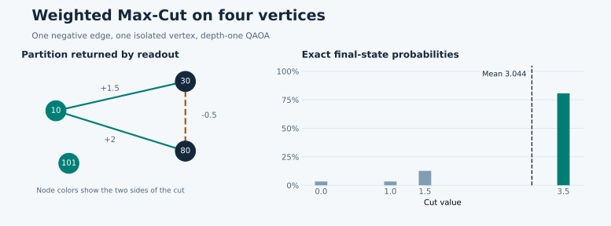

# QA_max_cut_lib

**Weighted Max-Cut, from exact enumeration to QAOA, RQAOA, and local search.**
Version **0.1.0rc2**. The library targets small and medium graphs, teaching,
and reproducible algorithm comparisons on CPU and NVIDIA GPU.

## First result in one minute

You need Python 3.10 or newer. Install the CPU profile and run the public example:

```bash
python -m pip install ".[cpu]"
python examples/public_quickstart.py
```

The example solves a four-vertex graph with one negative edge:

```text
Exact optimum                    3.500000
Expected QAOA cut               3.044365
Best cut in 128 simulated shots 3.500000
Final-state optimal mass        0.805755
Readout spins                   {10: 1, 30: -1, 80: -1, 101: 1}
```

The numbers are reproducible with `seed=42`. Exact enumeration gives an optimum
of `3.5`; depth-one QAOA with fixed initialization has expected cut `3.044365`
and returns an optimal cut in one of 128 measurements.



## What problem is solved

A graph `G=(V,E)` has real weights `w_ij`. Spins `s_i ∈ {-1,+1}` define two
sides of a cut. An edge crosses the cut when its endpoints have opposite signs.
The cut weight and energy are:

```text
C(s) = Σ_(i,j) w_ij (1 - s_i s_j) / 2
E(s) = -C(s)
```

A positive edge rewards separation; a negative edge rewards keeping its
endpoints together. Isolated vertices do not affect `C`. Maximizing `C` is
equivalent to minimizing `E`; in this library `solution_energy = -cut_value`.
The constant energy term is retained when exact comparisons or reductions need it.

For one edge of weight `2`, separated spins give `C=2, E=-2`; equal spins give
`C=0, E=0`. This is the simplest check of the energy sign and phase-operator sign.

## Available solvers

| Task | Public class | Main limitation |
|---|---|---|
| Exact reference on small graphs | `ExactCPU` | exponential enumeration |
| Full-statevector QAOA | `QAOACPU` | memory grows as `2^n` |
| Recursive RQAOA | `RQAOACPU` | heuristic correlation choices |
| LS-RQAOA with local tasks | `LSRQAOACPU` | heuristic, shared shot budget |
| NVIDIA QAOA / RQAOA / LS | `QAOAGPU`, `RQAOAGPU`, `LSRQAOAGPU` | requires CuPy and CUDA |
| Classical GW/SA | `GoemansWilliamsonCPU`, `SimulatedAnnealingCPU` | SDP/heuristic, `classical` extra |
| Hierarchical QAOA-in-QAOA | `QAOAInQAOACPU` | explicit block coverage and sizes |
| Laboratory transfers | `laboratory.*` | some controllers are incomplete |

Method selection, costs, and caveats are summarized in
[Choosing an algorithm](docs/CHOOSE_ALGORITHM.md).

## Installation

Full CPU environment with classical references, notebooks, and Sphinx:

```bash
python -m venv .venv
source .venv/bin/activate        # Windows: .venv\Scripts\activate
python -m pip install -e ".[cpu,classical,notebooks,docs]"
```

Minimal CPU profile:

```bash
python -m pip install -e ".[cpu]"
```

NVIDIA profiles are separate: `gpu-cu12` and `gpu-cu13`. Importing the package
without CUDA does not require CuPy. Exact commands and environment checks are in
[Installation](docs/INSTALLATION.md).

## Your first calculation

```python
from QA_max_cut_lib import ExactCPU, QAOACPU, WeightedGraph

graph = WeightedGraph(
    edges=[(10, 30, 1.5), (10, 80, 2.0), (30, 80, -0.5)],
    nodes=[10, 30, 80, 101],          # 101 is isolated
)

reference = ExactCPU()
reference.solve(graph)
print(reference.cut_value)             # 3.5

qaoa = QAOACPU({
    "seed": 42,
    "parameters": {"layers": 1},
    "objective": {"type": "mean_cut"},
    "estimation": {"mode": "exact"},
    "initialization": {
        "type": "fixed_angles",
        "parameters": {"values": [-0.8, 0.4]},
    },
    "optimizer": {"parameters": {"max_steps": 24}},
    "readout": {"mode": "best_of_shots", "shots": 128},
    "limits": {"shots_total": 128},
    "collect": {"probabilities": True},
})
solution = qaoa.solve(graph)
print(solution)                        # original labels -> ±1
print(qaoa.expected_cut)               # 3.044365...
print(qaoa.cut_value)                  # selected cut
```

`QAOACPU` keeps integer vertex labels; it does not reindex them.
`qaoa.probabilities` follows `qaoa.node_order`: the least-significant bit belongs
to the first vertex in that order. Use the same ordering when reconstructing a
distribution by hand.

## Documentation

Start with the [Quickstart](docs/QUICKSTART.md), then read
[Concepts](docs/CONCEPTS.md) and the
[scientific Max-Cut chapter](docs/weighted_max_cut.rst).

- [Choosing an algorithm](docs/CHOOSE_ALGORITHM.md)
- [API: types, defaults, and exceptions](docs/API.md)
- [Mathematical conventions](docs/MATHEMATICS.md)
- [Configuration](CONFIGURATION.md)
- [Saving results](RESULTS_AND_SAVE.md)
- [Checkpoint and resume](docs/CHECKPOINTS.md)
- [Experiment series](docs/EXPERIMENTS.md)
- [NVIDIA GPU](docs/GPU.md)
- [Mutual-information diagnostics](docs/MUTUAL_INFORMATION.md)
- [Generators and typed plans](docs/GENERATORS_PLANS.md)
- [Legacy compatibility adapters (R19)](docs/LEGACY_COMPATIBILITY.md)
- [Architecture](docs/ARCHITECTURE_MAP.md)
- [Release status and limitations](RELEASE_READINESS.md)

## Notebooks and examples

Executable notebooks live in `notebooks/`; HTML previews are in
`docs/notebook_previews/`. Main entry points:

- `notebooks/00_quickstart.ipynb` — installation and first result;
- `notebooks/01_full_guide.ipynb` — configuration, plots, saving;
- `notebooks/04_rqaoa_cpu.ipynb` — RQAOA;
- `notebooks/06_ls_rqaoa_cpu.ipynb` — local search;
- `notebooks/17_mutual_information_diagnostics.ipynb` — passive diagnostics;
- `notebooks/18_incremental_ls_mk_strategies.ipynb` — incremental LS;
- `notebooks/19_generators_and_partition_coverage.ipynb` — generators and plans.

Modules can also be run as CLIs:

```bash
python -m QA_max_cut_lib.solvers.exact_cpu --report 1 --logs 0
python -m QA_max_cut_lib.solvers.qaoa_cpu \
  --graph configs/graphs/complete_signed_7.json \
  --config configs/solvers/qaoa_cpu.json --report 1
```

## Verification

```bash
python -m pytest -q
python -m sphinx -W -b html docs docs/_build/html
python -m build
```

In the current environment: `233 passed, 1 skipped`; Sphinx builds with `-W`;
GPU tests `10 passed` on a local RTX 3050. Wheel installation is checked outside
the source tree in a separate environment.

## Status

`0.1.0rc2` contains all 65 requirements. CPU/GPU solvers, reductions, RQAOA, LS,
generators, typed plans, diagnostics, and Laboratory components are implemented.
R19 is closed: all 89 archive records have a terminal disposition, including 18
compatibility adapters in `QA_max_cut_lib.laboratory.legacy`. See
[RELEASE_READINESS.md](RELEASE_READINESS.md) and
[SOURCE_CLOSURE.json](SOURCE_CLOSURE.json).

No public distribution license has been assigned yet; the package is not on
PyPI. Source comments and docstrings are in technical English.
