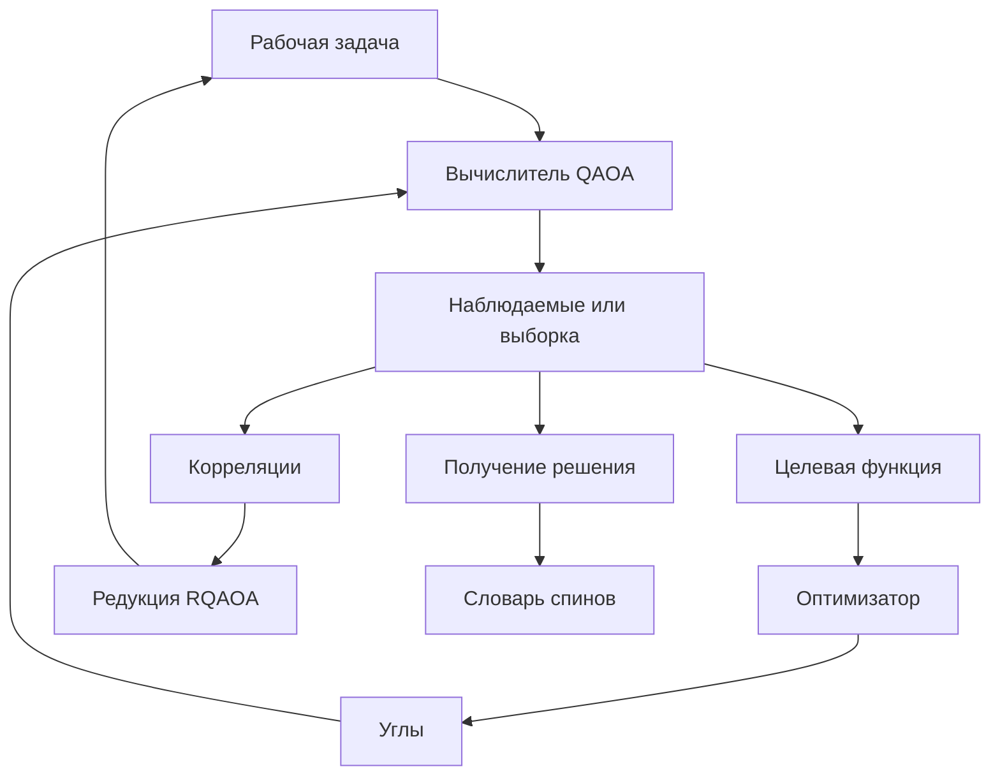

# QA_max_cut_lib: требования и проект архитектуры

**Версия:** 0.10, 1 ноября 2026 года.  
**Стадия:** проектирование по результатам разбора кода и обсуждения требований.

**Название пакета и Python-импорта:** QA_max_cut_lib. Регистр и подчёркивания сохраняются.

Документ фиксирует принятые решения и предлагает устройство библиотеки. Раздел «Согласованные требования» отражает ответы пользователя. Имена классов, конкретные поля JSON и технические правила последующих разделов — проект реализации для дальнейшего уточнения.

Источник — [RQAOA_main.rar](https://chatgpt.com/library?file_id=libfile_6ad1141395e88191a0b4aaa32e78b1c5&account_id=personal). Пути исходников ниже указаны относительно каталога RQAOA_main внутри архива.

**SHA-256 исходного архива:** b4c684a5d4da469adc25bd99a405e402892d1a2524465e4c97ab6229c71a4aed

Проведён статический анализ структуры 89 Python-файлов, зависимостей и повторяющихся методов; основные семейства изучены подробнее. Объём — 25 548 строк. Численные результаты, точность и производительность исходных алгоритмов в рамках этого разбора не проверялись.

## Согласованные требования

| № | Требование |
|---|---|
| R01 | Четыре основных раздела: Solvers, Tools, Generators, Laboratory. Архитектура использует ООП. |
| R02 | Составные алгоритмы собираются из заменяемых компонентов. У LS-RQAOA независимо выбираются источник корреляций, построитель подграфов, правило редукции и завершающий солвер. |
| R03 | Один экземпляр солвера принимает разные графы: solver.solve(graph). |
| R04 | Солвер хранит дополнительные результаты последнего запуска. Историю нескольких запусков собирает отдельный объект эксперимента. |
| R05 | Каждый обычный solve() начинает новый запуск. Предыдущие углы, решения и продолжение вычислений используются явно. Подходящие рабочие буферы допускается переиспользовать. |
| R06 | Заданный seed заново применяется при каждом новом запуске. |
| R07 | Объект графа изменяемый. |
| R08 | Внешние номера вершин — целые числа с возможными пропусками. Подграфы и решения сохраняют исходные номера. |
| R09 | JSON графа содержит рецепт генерации: тип генератора, параметры и seeds. |
| R10 | Ориентир ближайших экспериментов — полные графы до примерно 1 000 вершин. |
| R11 | Все графы взвешенные. Единичные веса представляют обычный невзвешенный случай. |
| R12 | CPU- и GPU-реализации представлены самостоятельными алгоритмами. |
| R13 | Нормальный результат солвера — словарь исходный_номер_вершины → +1 или −1. Дополнительные результаты доступны отдельно. |
| R14 | Для редукции разрешены существующие рёбра или произвольные пары — по настройке алгоритма. |
| R15 | QAOA поддерживает получение решения как наиболее вероятного состояния или лучшего из M шотов. |
| R16 | Пользовательский вход — задача Max-Cut на взвешенном графе. Локальные поля формируют сами алгоритмы внутри вычислений. |
| R17 | При обучении QAOA выбирается точная оценка целевой функции или оценка по шотам. |
| R18 | Включаются Mean Cut, CVaR, Gibbs, Best-of-K и Threshold Probability с настройкой их параметров. |
| R19 | В Laboratory сохраняются все содержательно различающиеся экспериментальные версии из архива. |
| R20 | Старые скрипты можно адаптировать под новый единый интерфейс. |
| R21 | Новые компоненты добавляются в исходный код библиотеки. |
| R22 | Нужен общий механизм запуска серий экспериментов и сбора результатов. |
| R23 | Серия выполняется на одной машине. CPU/GPU выбирается для каждого солвера; смешанные серии разрешены. |
| R24 | Нужны общий бюджет шотов на запуск и настраиваемые лимиты работы отдельных этапов, например число шагов оптимизации. |
| R25 | Общий бюджет шотов строгий: превышение запрещено. |
| R26 | По умолчанию сохраняются основные итоги; подробные данные включаются через конфигурацию. |
| R27 | Поддерживается продолжение прерванного алгоритма из контрольной точки. |
| R28 | Эталоны: перебор для малых задач, GW для средних, сравнение энергий методов и лучшее известное решение для больших. |
| R29 | В Tools нужен готовый расчёт ландшафтов QAOA по сетке и их визуализация. |
| R30 | Generators создаёт исходные графы, подграфы и разбиения. Инициализация QAOA остаётся среди компонентов солверов. |
| R31 | Каждый модуль полноценного солвера содержит самостоятельный запуск через if __name__ == "__main__":, включая CPU/GPU-реализации и Laboratory. |
| R32 | Tools строит гистограммы распределения вероятностей: плоские и в виде столбцов на координатной плоскости, в том числе для распределений большого размера. |
| R33 | Ландшафты отображаются как плоские тепловые карты и интерактивные трёхмерные поверхности с сохранением в HTML. |
| R34 | Для RQAOA и его составных вариантов Tools строит траектории параметров по шагам редукции: на плоскости и в интерактивном трёхмерном HTML. |
| R35 | После solve() algorithm.result предоставляет JSON со всеми конечными результатными атрибутами, метаданными и накопленными данными последнего запуска. |
| R36 | Каждый результатный атрибут также доступен непосредственно как algorithm.attribute_x. Прямой доступ и result описывают одни данные. |
| R37 | Код максимально прозрачен. Подробные комментарии и docstrings следуют ASD-STE100 и объясняют алгоритм, математический смысл и причину каждого нетривиального преобразования. |
| R38 | Автоматический итоговый отчёт имеет независимый аргумент уровня: 0 — выключен, 1 — краткий, 2 — развёрнутый. |
| R39 | Логи имеют независимый аргумент уровня: 0 — выключены, 1 — краткие, 2 — развёрнутые. Логи и отчёт имеют единое аккуратное оформление и цветовую дифференциацию. |
| R40 | Tools строит кривые оптимизации на основе накопленных данных; соответствующая функциональность из базовых алгоритмов переносится в общий инструмент. Для семейства LS основной график прогресса заменяется энергетическими графиками редукций, указанными в R42–R43. |
| R41 | Tools поддерживает простую отрисовку взвешенного графа, графа с решением и графа с основной информацией о задаче. |
| R42 | Для семейства LS основной график прогресса показывает зафиксированную энергию в редуцированных рёбрах по шагам редукции. |
| R43 | Для LS зафиксирована энергетическая нотация E = −C. Вклад выбранного ребра после фиксации равен −w(1−σ)/2, его математическое ожидание по корреляции — −w(1−c)/2. Строятся значения по шагам и накопленные суммы без нормировки. |
| R44 | Для LS и RQAOA строятся траектории оптимизированных параметров на каждом шаге редукции. Для p слоёв включаются все неупорядоченные пары из 2p параметров; доступны плоские графики и интерактивный HTML с номером редукционного шага по оси Z. |
| R45 | Нужны графики веса выбранного редуцируемого ребра от номера редукции и среднего модуля веса ребра от номера редукции. |
| R46 | Пакет сопровождается подробными исполняемыми учебными ноутбуками по использованию основных возможностей. |
| R47 | Все графики имеют единый LaTeX-стиль и LaTeX-шрифт, включая подписи, легенды, шкалы и интерактивный HTML. |
| R48 | Параметры каждого графика передаются в соответствующий инструмент через конфигурационный JSON. |
| R49 | Все алгоритмы и инструменты используют необязательный раздел save в конфигурации. При его отсутствии автоматический экспорт соответствующих результатов не выполняется. |
| R50 | Для графики save задаёт path, format, DPI, filename, metadata, makedir и при необходимости savedir. Основной файл называется filename.format. При metadata = true внизу графика указываются дата и время, алгоритм, параметры запуска и задачи. |
| R51 | Результат алгоритма сохраняется в JSON с датой и временем, всеми использованными параметрами солвера и графа, временем расчёта, числом этапов, подробным отчётом и атрибутами, выбранными через atts. |
| R52 | Атрибуты из save_original_data дополнительно сохраняются в собственных форматах с основой имени filename_attributename; для массива NumPy используется .npy. |
| R53 | makedir разрешает создание отсутствующего path. При savedir = true внутри path создаётся папка filename, в которую помещается весь сохраняемый набор. |
| R54 | Защита от перезаписи обязательна для всех файлов и папок сохраняемого набора, включая дополнительные массивы и коллекции графиков. |
| R55 | Нужен отдельный исполняемый ноутбук быстрого старта с основными примерами запуска, настройки, визуализации и сохранения. |
| R56 | Нужен отдельный подробный ноутбук с описанием всего функционала пакета. Тематические ноутбуки дополняют его. |
| R57 | Формулируются отдельные наборы зависимостей для CPU и NVIDIA GPU. Установка и использование CPU не требуют GPU или CUDA. |
| R58 | Каждый алгоритм и функция документируются в репозитории в стиле NumPy/SciPy: строгая физическая и математическая постановка, все аргументы, результаты и атрибуты. |
| R59 | Общий аргумент num_treads управляет CPU-параллелизмом; он описан в сигнатурах, JSON и документации. |
| R60 | Реализуется параллельное исполнение независимых локальных задач, особенно подграфов LS и независимых задач QAOA-in-QAOA, с сохранением зависимостей алгоритма. |
| R61 | Tools содержит профилировщик CPU-параллелизма перед бенчмарком. Он принимает ту же спецификацию задач и солверов, что и общий бенчмарк. |
| R62 | Профилировщик разворачивает все допустимые комбинации заданной сетки параметров и использует один выбранный seed. Рекомендация числа потоков оптимизируется для всего диапазона конфигураций. |
| R63 | Строятся кривые времени, скорости и ускорения от числа ядер/потоков; оцениваются эффективность, коэффициенты параллелизуемости и процент последовательной части с указанием модели и качества оценки. |
| R64 | Seaborn предпочтителен для статистической 2D-визуализации. Оформление Another_pars.py служит пользовательским референсом общей темы с сохранением LaTeX-шрифта и JSON-настройки. |
| R65 | Название пакета и Python-импорта — QA_max_cut_lib. В примерах, структуре исходников и командах запуска используется это имя с указанным регистром. |

## Что показывает исходный код

| Каталог | Python-файлов | Наблюдаемая роль |
|---|---:|---|
| Solvers | 18 | Основные солверы, а также Benchmark и проверочные скрипты |
| Laboratory | 22 | Экспериментальные алгоритмы, построение подграфов и диагностика |
| Diplom | 28 | Исторические серии MK, варианты QAOA с полями и QAOA-in-QAOA |
| Tools | 11 | Разбиения, метрики, генераторы и алгоритмы MI-QAOA |
| Generators | 3 | Генерация графов и наборов задач, исследование нелокальности |
| ENV | 3 | Дополнительные реализации QAOA, GW и генераторов |
| Other | 2 | Варианты warm-start QAOA и экспериментальные сценарии |
| RQAOA_exp | 2 | Дополнительная пара QAOA/RQAOA |
| **Итого** | **89** | |

В исходниках уже присутствуют несколько архитектурных подходов. RecursiveQAOA наследуется от QAOA и изменяет его внутреннее состояние. LargeScaleRQAOA создаёт локальные QAOA и ClassicSolver внутри своих методов. QAOA-in-QAOA организует иерархию локальных задач; одна его реализация использует глобальные переменные.

Эти различия требуют общего интерфейса вычислительных возможностей, а не общего большого родительского класса со всеми массивами и методами.

В Solvers/LS_RQAOA.py зафиксированы конкретные классы QAOA, построителя плотных подграфов и точного завершающего метода. В Diplom/Mk_8_3.py источник корреляций уже заменён на QAOA-in-QAOA. В Diplom/Mk_5_2.py подграфы после редукции обновляются около затронутых вершин. Это примеры самостоятельных точек расширения.

Дублирование существенно: один и тот же метод визуализации сходимости встречается в 13 файлах; определения с именем _graph_reduction встречаются 32 раза. Эти числа характеризуют структуру кода. Совпадение метода или имени класса само по себе не доказывает эквивалентность алгоритмов: могут различаться зависимости, правила инициализации и используемые данные.

### Существенные замечания статического аудита

| Источник | Наблюдение | Следствие для переноса |
|---|---|---|
| Solvers/QAOA.py, QAOA_GPU.py | Хранится половина симметричного состояния; сумма сохранённых вероятностей равна 1/2 | Представление состояния и его нормировка должны быть явно известны общим функциям |
| Solvers/QAOA.py:mean_map | Корреляции вычисляются по половине вероятностной массы без множителя 2 | Проверить и исправить физическую нормировку корреляторов при переносе |
| Solvers/QAOA.py:361–362 | result используется как флаг совпадения с одним точным решением с учётом глобальной инверсии | Освободить result для общего JSON-контракта. Совпадение с эталоном хранить отдельным полем; отсутствие такого совпадения не доказывает неоптимальность |
| Solvers/WS_QAOA.py и варианты с полями | Используют полный вектор состояния | Унификация массивов требует учёта представления, а не одинаковой формулы над сырыми probs |
| Solvers/WS_QAOA.py:64, 87–116 | Начальное решение выбирается с использованием точного оптимума полного перебора; переданный initial_state заменяется внутренним выбором | Сохранить такую стратегию как явно названную инициализацию с использованием точного эталона; отдельно реализовать передачу начального решения |
| Solvers/AnalyticalQAOA.py | Возвращает углы и ожидание, ограничен единичными весами и не получает словарь спинов | Представить его вычислительную часть как оцениватель; полноценному солверу нужен отдельный этап получения решения |
| Solvers/AnalyticalRQAOA.py | Уже содержит взвешенную формулу p=1, корреляции, константу редукции и восстановление исходных номеров | Использовать как источник самостоятельных аналитических и редукционных компонентов |
| Solvers/QAOA_GPU.py | В одном классе переключаются NumPy и CuPy | В новом API зарегистрировать отдельные CPU/GPU-реализации |
| Solvers/FineTuning.py:83 | В обеих ветвях преобразования спина записывается '1' | Исправить ошибку выходного решения и проверить улучшение на исходном графе |
| Solvers/Dwave_aneal.py:31 | При минимизации Ising-энергии задаётся J = −w/2 | Для E = −C требуется J = +w/2 и соответствующая константа; текущий знак задаёт другую цель |
| Solvers/Dwave_aneal.py:79 | Найденная выборка остаётся локальной переменной | Привести выдачу решения к общему контракту |
| Solvers/Dwave_aneal.py | Используется SimulatedAnnealingSampler | В каталоге это классический имитированный отжиг, а не запуск на квантовом устройстве |
| Solvers/GoemansWilliamson.py | Номера вершин используются как индексы SDP-матрицы, а индексы округления — как метки вершин | Добавить явное отображение внешних номеров во внутренние индексы |
| Tools/GraphDecomposer.py, PartitionEfficiency.py | Взаимный импорт | Развести генерацию и оценку разбиений |
| Tools/MutInfo.py | Создаётся полная матрица плотности через внешнее произведение; есть демонстрационные вычисления при импорте | Выделить диагностику, убрать демонстрацию из импорта; вычислять малые редуцированные матрицы без полной матрицы плотности |
| Несколько каталогов | Неоднозначные импорты вроде from QAOA import QAOA, глобальные настройки предупреждений и графиков | Перейти на пакетные импорты и явные настройки |

Для замечания об отжиге достаточно раскрыть соглашение о знаке:

$$
-C(s)=-\frac12\sum_{\{i,j\}}w_{ij}
+\frac12\sum_{\{i,j\}}w_{ij}s_i s_j.
$$

Поэтому коэффициент парного взаимодействия при минимизации −C положителен относительно w. Историческое имя файла не определяет вычисляемую задачу.

## Главный принцип предлагаемой архитектуры

Разделить **описание алгоритма**, **состояние одного запуска** и **вычислительные компоненты**.

Экземпляр солвера хранит конфигурацию, компоненты, подходящие рабочие буферы и результаты последнего запуска. При solve(graph) создаётся новое состояние запуска. При явном восстановлении состояние загружается из контрольной точки.

Это разделение согласует переиспользование одного солвера, независимость новых запусков, экономию памяти и продолжение прерванных вычислений.

## Распределение ответственности между модулями

Ниже предложено размещение функциональности. Четыре публичных раздела сохраняются; небольшой внутренний Core содержит общие типы и правила выполнения.

| Раздел | Ответственность |
|---|---|
| Solvers | Полноценные алгоритмы Max-Cut; собственные вычислительные реализации CPU/GPU; компоненты оптимизации и инициализации |
| Generators | Исходные взвешенные графы, распределения весов как часть их рецептов, подграфы и разбиения |
| Tools: численные функции | Вероятности, выборки, корреляторы, преобразования представлений и другие переиспользуемые операции |
| Tools: анализ | Метрики качества, статистика серий, диагностика разбиений, взаимная информация |
| Tools: визуализация | Взвешенные графы и решения, гистограммы вероятностей, кривые оптимизации и редукций, тепловые карты, все попарные траектории параметров LS/RQAOA, интерактивный HTML и единый LaTeX-стиль |
| Tools: представление результатов | Общие форматтеры отчётов и логов, уровни подробности и цветовая тема |
| Tools: сохранение | Единый экспортёр результатов и графики по save, сериализаторы исходных данных, метаданные и защита от перезаписи |
| Tools: исследования | ExperimentRunner, LandscapeScanner и ParallelismProfiler для подбора CPU-ресурса перед бенчмарком |
| Laboratory | Экспериментальные алгоритмы и компоненты; именованные сборки, соответствующие историческим версиям |
| Core, внутренний | Граф и отображения индексов, конфигурации, контракты, результаты, состояние запуска, бюджет, случайность, CPU-ресурсы и контрольные точки |

Классы используются для сущностей с состоянием, конфигурацией или заменяемым поведением. Простые математические преобразования могут оставаться функциями. ООП не требует оборачивать каждую формулу в класс.

Численные функции Tools должны иметь лёгкие зависимости и не импортировать запускатор, визуализацию или конкретные экспериментальные солверы. Анализ получает результаты через общие типы. Запускатор получает фабрику компонентов через отдельный уровень сборки.

Laboratory может использовать Solvers, Generators и общие функции. Базовые солверы используют общие интерфейсы; их импорт не должен требовать Laboratory. Общие типы Core не зависят от конкретных алгоритмов. Начальная загрузка пакета остаётся лёгкой, а дополнительные зависимости загружаются при обращении к соответствующему функционалу.

### Основные объекты

| Объект / интерфейс | Назначение |
|---|---|
| WeightedGraph | Изменяемый исходный граф с явными весами и стабильными внешними номерами |
| MaxCutSolver | Общий интерфейс solve(graph), возвращающий полный словарь спинов |
| RunRecord | Независимая запись одного запуска; единый источник данных для result и прямых результатных атрибутов |
| RunState | Текущее состояние алгоритма, достаточное для продолжения |
| RunContext | Сервисы одного запуска: бюджет, случайность, сбор данных и контрольные точки |
| ParallelContext | CPU-бюджет одного запуска, исполнитель локальных задач и политика вложенных пулов |
| QAOAEvaluatorCPU / QAOAEvaluatorGPU | Вычисления при заданных углах без обязательного запуска оптимизации |
| CorrelationProvider | Получение оценок корреляций вместе с областью покрытия и сведениями об оценке |
| SubgraphGenerator | Построение выбранных подграфов или разбиения |
| PairSelector | Выбор пары и знака ограничения по разрешённым и доступным оценкам |
| GraphReducer | Применение ограничения, обновление задачи и информации восстановления |
| MaxCutSolver в роли завершающего метода | Решение оставшегося графа после редукций |
| Refiner | Улучшение переданного полного решения, например локальная коррекция |
| ExperimentRunner | Серии запусков, отдельная история, эталоны и сохранение |
| BenchmarkSpec / план испытаний | Общий вход бенчмарка и профилировщика: графы, солверы, сетки параметров, seeds, лимиты и режим измерений |
| ParallelismProfiler | Измерения масштабирования, оценка эффективной последовательной части и рекомендация числа CPU-потоков для всего плана |
| LandscapeScanner | Обход сетки и сбор карт при фиксированных параметрах; результат передаётся средствам визуализации |
| DistributionData | Распределение по состояниям или частоты измерений с порядком битов, нормировкой и способом представления |
| ParameterTrace | Параметры и выбранные характеристики по шагам редукции с привязкой к задаче и локальному вызову |
| ReductionHistory | Веса выбранных пар, физические корреляции, знаки ограничений, вклады энергии, константа редукции и статистика рабочего графа по шагам |
| OptimizationHistory | История шагов оптимизатора и оценок целевой функции с явными счётчиками и этапами |
| Средства визуализации Tools | Отрисовка сохранённых распределений, карт и траекторий; статические изображения и интерактивный HTML |
| Средства вывода Tools | Форматирование событий и итоговой записи; согласованные цвета, таблицы и подписи |
| SaveManager / сериализаторы данных | Общая обработка save, выбор атрибутов, план имён файлов и сохранение без замены существующих данных |

Это роли объектов. Окончательные имена классов и сигнатуры вспомогательных методов уточняются при реализации.

## Зависимости и профили установки

Обязательны отдельные CPU- и NVIDIA-профили установки. Основной импорт пакета и все CPU-сценарии работают без CuPy, CUDA и NVIDIA-драйвера. GPU-модуль проверяет зависимости при обращении к GPU-реализации и сообщает конкретную причину недоступности. Выбор GPU не превращается автоматически в CPU-алгоритм.

Ниже сформулирован проект состава зависимостей. Это список для формирования файлов установки и проверки окружений; его не следует выдавать за уже протестированный набор фиксированных версий нового пакета.

| Группа | Пакеты | Назначение |
|---|---|---|
| Общие вычисления и данные | numpy, scipy, networkx, pandas | Массивы, численные методы, взвешенные графы и таблицы результатов |
| Конфигурация и вывод | jsonschema, rich | Проверка JSON и единые отчёты, логи и прогресс |
| Визуализация | matplotlib, seaborn, plotly | Статистические 2D-графики Seaborn/Matplotlib и интерактивные представления |
| CPU-параллелизм и диагностика | joblib, threadpoolctl, psutil | Исполнители задач, контроль нативных пулов и сведения о ресурсах |
| Классические методы | cvxpy, scs, dwave-samplers, dimod | SDP-метод GW и классический имитированный отжиг |
| Дополнительные разбиения | python-louvain | Сохранение функциональности разбиений, использующей community_louvain |
| Ноутбуки | jupyterlab, ipykernel, nbformat, nbclient | Запуск, редактирование и проверка учебных ноутбуков |
| Сборка справочника | sphinx, numpydoc, pydata-sphinx-theme, myst-nb | Документация API, математические разделы и материалы ноутбуков |

Полный CPU-профиль включает общие вычисления, конфигурацию, вывод, визуализацию, CPU-диагностику и поддерживаемые CPU-методы. Группы ноутбуков и сборки документации устанавливаются отдельно через requirements/notebooks.in и requirements/docs.in с составом из таблицы. GPU-профиль добавляет выбранный CuPy к CPU-возможностям. Формат установки предлагается оформить extras в pyproject.toml и отдельными исходными списками требований.

Проект requirements/cpu.in:

```text
numpy
scipy
networkx
pandas
jsonschema
rich
matplotlib
seaborn
plotly
joblib
threadpoolctl
psutil
cvxpy
scs
dwave-samplers
dimod
python-louvain
```

Для NVIDIA выбирается один из двух профилей:

| Файл | Дополнение к CPU-профилю |
|---|---|
| requirements/gpu-nvidia-cu12.in | cupy-cuda12x[ctk] |
| requirements/gpu-nvidia-cu13.in | cupy-cuda13x[ctk] |

Каждый такой файл включает cpu.in и ровно один CuPy-вариант. По [официальной инструкции CuPy](https://docs.cupy.dev/en/stable/install.html), вариант wheel зависит от CUDA, а extra ctk устанавливает нужные CUDA-компоненты в окружение; совместимый NVIDIA-драйвер требуется отдельно. При использовании системного CUDA Toolkit допускается профиль без ctk с явно проверенной совместимостью. Устанавливать оба CuPy-варианта в одно окружение не следует.

Профиль выбирается по GPU, драйверу, CUDA и поддерживаемой версии Python. CUDA 13 не является универсальной заменой CUDA 12 для старых GPU: [NVIDIA указывает удаление поддержки Maxwell, Pascal и Volta](https://docs.nvidia.com/cuda/archive/13.0.0/cuda-toolkit-release-notes/index.html). Установка проверяет доступность устройства и компиляцию используемого ядра, а не только успешный import cupy.

SCS предлагается как открытый SDP-бэкенд для первого CPU-профиля GW; конкретный бэкенд, допуски и статус решения входят в конфигурацию и результат. Другие бэкенды могут быть отдельными зависимостями. Собственная CMA-ES из архива сама по себе не требует внешнего пакета cma. Неиспользуемые импорты исходников не переносятся в зависимости автоматически; например, импорт dimension из SymPy в GraphGenerator.py не используется.

LaTeX-движок и необходимые шрифты являются системными зависимостями выбранного режима оформления. Они описываются отдельно от Python-пакетов. HTML-материалы получают необходимые ресурсы при экспорте по ранее заданным правилам автономности.

Для релиза создаются проверенные lock-файлы и матрица Python/ОС/CPU/NVIDIA. В результатах экспериментов сохраняются версии пакета, NumPy/SciPy, используемого BLAS/OpenMP и, для GPU, CuPy, CUDA и драйвера. Совместимость и точные ограничения версий объявляются по результатам проверки установки, исполнения алгоритмов, ноутбуков и сборки документации.

## Контракт графа и решения

Внешние номера вершин сохраняются при построении подграфов и в выходных словарях. Для вычислений строится отдельное отображение номер → индекс. Например, внешним номерам 2, 7, 15 соответствуют внутренние индексы 0, 1, 2.

Предлагаемая первая область определения — простой неориентированный граф с конечными вещественными весами, включая отрицательные и нулевые. Структуру с петлями или кратными рёбрами следует проверять при преобразовании во входной тип. Это техническое предложение на основе предположений текущих реализаций.

Каждое ребро имеет явный вес. Для единичного случая рецепт использует постоянный вес 1. Граф может хранить разреженное или плотное представление; выбор представления не меняет математическую задачу.

Граф обновляется через методы, поддерживающие его версию и отображение индексов. Для кэша недостаточно только номера версии: у двух разных объектов может быть одинаковая версия. Ключ должен учитывать идентичность графа и его актуальное состояние. Для долговременных записей нужен устойчивый идентификатор содержимого.

Солвер сохраняет содержимое переданного графа. Редукции выполняются над отдельной рабочей задачей. В записи запуска фиксируется состояние исходного графа, к которому относится ответ.

Словарь решения содержит каждую исходную вершину ровно один раз; значения — обычные целые +1 или −1. Перенумерация внутренних массивов, удаление изолированных вершин и промежуточные слияния должны быть полностью учтены при восстановлении.

Общая конвенция качества:

$$
C_G(s)=\frac12\sum_{\{u,v\}\in E}w_{uv}(1-s_us_v).
$$

Максимизируется C_G. В общей записи результата предлагаются отдельные поля:

| Поле | Значение |
|---|---|
| solution | Полный словарь исходных номеров и спинов |
| cut_value | C_G(solution), вычисленный на исходном графе |
| solution_energy | −C_G(solution) |
| expected_cut | Математическое ожидание разреза, когда оно доступно |
| objective_value | Значение выбранного критерия обучения |
| optimizer_loss | Значение, передаваемое минимизирующему оптимизатору |

Число objective_value у Threshold Probability безразмерно; у Mean Cut оно выражает средний вес разреза. Их нельзя объединять в один неуточнённый столбец energy. Модуль значения энергии не заменяет соглашение о знаке.

Для квантовой эволюции предлагается сохранить конвенцию основного QAOA из архива: H = −Ĉ и фаза exp(−iγH). Аналитические формулы, использующие +Ĉ, приводятся к ней явным преобразованием знака γ. Представление гамильтониана и критерий обучения — отдельные понятия: смена CVaR на Gibbs меняет критерий, а не автоматически фазовый оператор.

Внутренние локальные задачи могут иметь вид c + Σ h_i s_i + Σ J_ij s_i s_j. Они хранятся отдельно от исходного графа. Локальное значение такого функционала не следует выдавать как разрез исходного графа.

## Запуск, результат и продолжение

Предлагаемый пользовательский вид:

```python
solver = SolverFactory.from_config(solver_config)

solution_a = solver.solve(graph_a)
result_a = solver.result

solution_b = solver.solve(graph_b)
result_b = solver.result
```

Каждый solve() создаёт новый RunState и заново инициализирует случайность заданным seed. Подготовленные буферы используются повторно, когда подходят форме, типу данных и текущей задаче.

RunRecord — отдельная запись с собственным словарём решения. Последующий solve() не изменяет ранее полученные решения и сохранённые записи. Для включённых в запись крупных массивов необходимо определить владение данными: ссылка на перезаписываемый рабочий GPU-буфер не является сохранённым результатом.

Один экземпляр солвера выполняет один активный запуск. Для параллельных заданий запускатор использует отдельные экземпляры исполнителей. Это соответствует устройству текущего GPU-кода с общими рабочими буферами внутри экземпляра.

Основной RunRecord содержит идентификатор реализации, разрешённую конфигурацию, идентификатор графа, seed, решение, его качество, статус, время и счётчики. Подробности подключаются через collect. Состояние, необходимое для продолжения алгоритма, относится к RunState и может сохраняться независимо от настройки пользовательской диагностики.

### algorithm.result и прямые атрибуты

Обязательный пользовательский контракт: solve() по-прежнему возвращает словарь исходный_номер_вершины → ±1, а algorithm.result предоставляет полный итог последнего запуска. Предлагаемая форма в Python — обычный JSON-совместимый dict. Его можно сразу передать json.dump() или json.dumps(); преобразование в строку не требуется для доступа к отдельным полям. Это уточнение формы Python API, а не изменение требования о JSON.

Пример обращения:

```python
import json

solution = algorithm.solve(graph, report=1, logs=0)
result = algorithm.result

cut_value = algorithm.cut_value
history = algorithm.optimizer_history

result_text = json.dumps(result, ensure_ascii=False, allow_nan=False)
```

Каждый публичный результатный атрибут представлен именованным полем result. Например, result["cut_value"] и algorithm.cut_value дают одно значение; optimizer_history доступна обоими способами. Вложенные метаданные могут быть отдельными полями, например resources, timing и config. Для атрибутов со специальным представлением JSON используется документированное обратимое преобразование.

RunRecord служит единственным источником итоговых данных. Общие типизированные свойства и дополнительные поля конкретного алгоритма читают эту запись. Не допускается независимо собирать JSON и набор атрибутов из двух изменяемых копий. last_run можно сохранить как доступ к самой записи RunRecord; основная пользовательская точка полного экспорта — result. Новые поля Laboratory регистрируются вместе с именем, типом, описанием, единицами и правилом сериализации. Служебные имена API, например solve и result, не могут быть именами дополнительных полей.

Полный result включает идентификатор и версию реализации, схему результата, идентификатор запуска, конфигурации и seeds, сведения о фактически решённом графе, статус и причину завершения, решение и доступные оценки качества, конечные параметры, время, счётчики ресурсов и все собранные истории, распределения, корреляции и дополнительные результаты алгоритма. Для вложенных алгоритмов сохраняются их происхождение и связь с этапом, редукцией или подграфом. Научные результатные атрибуты не должны исчезать из экспорта из-за нестандартного имени или большого размера.

«Все накопленные данные» означает все данные, которые сохранены в результате данного запуска. collect по-прежнему управляет получением и сохранением подробной диагностики. Не собранные и не применимые к методу поля имеют явный статус, например not_collected или not_applicable, и значение null там, где поле предусмотрено схемой. Если публичный результатный атрибут доступен после solve(), его значение включается в result. Экспорт не должен молча заменять сохранённый массив кратким описанием или ссылкой.

Отдельная настройка save.atts явно выбирает подмножество атрибутов для файлового экспорта; это не меняет полноту algorithm.result. Список save_original_data независимо выбирает дополнительные файлы в исходных форматах. Правила выборочного сохранения описаны в разделе общего протокола.

Сам объект солвера, рабочие буферы, генераторы случайных чисел, GPU-дескрипторы и открытые файлы не являются результатными атрибутами. Для них используются внутренние поля. Состояние продолжения хранится в контрольной точке: result — полный научный итог запуска, а не снимок всех исполняемых объектов Python. Изменение оформления вывода не меняет состав этой записи.

Предлагаемые правила сериализации:

| Значение в Python | Представление в JSON |
|---|---|
| Обычные и NumPy/CuPy скаляры | Стандартные JSON-числа, строки, булевы значения или null |
| Числовые массивы | Значения, форма, тип данных и явно указанный порядок осей; без потери элементов |
| Комплексные числа и массивы | Отдельные действительная и мнимая части с описанием представления |
| Решение с целочисленными номерами вершин | Объект со строковыми ключами JSON; схема указывает восстановление целых номеров |
| Математически неопределённый показатель | null и отдельная причина недоступности; не NaN или Infinity |

В algorithm.solution и в возвращаемом значении solve() ключи остаются целыми числами. Загрузчик результата восстанавливает исходные целочисленные номера из JSON, включая отрицательные номера и пропуски. Передача сохранённых GPU-данных на CPU и создание JSON-представления выполняются при явном запросе результата; это не скрытая часть каждой итерации. Чтение result не запускает дополнительных измерений или оптимизации.

До первого запуска result имеет значение None. Объявленные результатные атрибуты до получения данных также имеют значение None; неизвестное имя атрибута вызывает обычный AttributeError. Новый solve() создаёт новую запись, не смешивая её с предыдущей. При неудачном запуске доступная частичная запись получает соответствующий статус; прежние результаты не выдаются как новые. Полученный dict result — независимый снимок: последующий solve() и изменение этого dict не меняют уже выданные снимки или внутренние результаты. Прямые результатные свойства предлагается сделать доступными только для чтения.

Пример явного восстановления:

```python
restored = SolverFactory.from_checkpoint(checkpoint_path)
solution = restored.resume()
result = restored.result
```

Восстановление использует сохранённое состояние генераторов случайных чисел. Повторная инициализация seed при продолжении привела бы к другой последовательности вычислений.

## Единый протокол сохранения

Раздел save — единая точка настройки автоматического экспорта результатов Solvers, Laboratory и Tools. При отсутствии save алгоритм или инструмент выполняет свою работу и возвращает результат без автоматического сохранения файлов и создания папок для экспорта. Настройки collect управляют сбором данных, output — консольным выводом и показом, save — записью на диск. Явно включённые контрольные точки остаются отдельным механизмом checkpoint; их не следует создавать как побочный эффект обычного экспорта.

Алгоритм передаёт экспортёру запись своего запуска. Для инструмента формируется запись его работы: имя и версия инструмента, конфигурация, исходные данные или идентификаторы запусков, время выполнения, доступные атрибуты и созданные артефакты. Эта запись не меняет обычный способ возврата графика или численного результата. Общий SaveManager использует запись производителя и сериализаторы по типам данных. Новому алгоритму или инструменту не требуется собственная реализация файлового экспорта.

### Общие параметры пути

| Поле | Смысл |
|---|---|
| path | Каталог назначения; относительный путь разрешается относительно явно определённого рабочего каталога |
| filename | Основное имя без расширения и без компонентов пути |
| makedir | Разрешить создание недостающего path и его родительских каталогов |
| savedir | Создать внутри path отдельную папку filename и поместить весь набор в неё |

Предлагаемые значения по умолчанию для makedir и savedir — false. Если path отсутствует и makedir = false, сохранение завершается ошибкой без записи файлов. Если path существует, savedir = true разрешает создать дочернюю папку filename даже при makedir = false: первый флаг относится к базовому пути, второй — к папке набора.

При savedir = false файл результата записывается как path/filename.json, а изображение — как path/filename.format. При savedir = true это соответственно path/filename/filename.json и path/filename/filename.format. Дополнительные файлы получают тот же каталог назначения. filename и имена атрибутов проверяются до записи, чтобы итоговые имена были однозначными и не меняли каталог назначения.

### Сохранение графики

Конфигурация инструмента содержит блок:

```json
{
  "save": {
    "path": "results/figures",
    "format": "png",
    "DPI": 300,
    "filename": "ls_reduction_energy",
    "metadata": true,
    "makedir": true,
    "savedir": true
  }
}
```

В примере создаётся файл results/figures/ls_reduction_energy/ls_reduction_energy.png. Поле сохраняет пользовательское написание DPI. Поддерживаются png, jpeg и pdf; интерактивные представления поддерживают html, а векторный экспорт может также включать svg. В пользовательском примере pdg трактуется как опечатка в pdf. Для форматов, которые не поддерживает конкретный рендерер, выдаётся понятная ошибка до записи.

DPI задаёт плотность растрового экспорта. Для векторных форматов он относится к растровым элементам, если они присутствуют; геометрия и шрифт не должны намеренно растрироваться ради DPI. У HTML параметр не меняет интерактивные данные; размер сцены задаётся настройками графика. Эти различия отмечаются в разрешённой конфигурации экспорта.

При metadata = true внутри экспортируемого изображения внизу размещается читаемый блок: дата и время запуска с часовым поясом, имя и версия алгоритма, фактически использованные вычислительные параметры, параметры графа и seeds, а также выбранный срез данных. Для результата инструмента указываются его имя и параметры; если входом был запуск алгоритма, сохраняется и этот контекст. Дата экспорта может указываться отдельно от даты исходного расчёта.

Подпись использует общий LaTeX-стиль. Под неё резервируется место, текст переносится, а размер итогового изображения корректируется так, чтобы не закрывать оси и не обрезать строки. Описание задачи включает параметры и идентификатор фактически решённого графа; крупные массивы его рёбер не разворачиваются в подпись вместо графика. При сравнении нескольких запусков источник каждой серии остаётся различимым. При metadata = false этот блок не добавляется.

Флаг metadata регулирует видимую подпись на графике. Он не означает автоматическое создание отдельного JSON-файла и не отключает обязательные метаданные JSON-результата алгоритма. Если визуализатору дополнительно заданы atts или save_original_data, общий экспортёр также создаёт JSON-запись инструмента и выбранные исходные данные по правилам следующего раздела.

Один блок save задаёт один формат. Для другого формата можно явно повторить экспорт готового результата с другим save без повторного расчёта научных данных. Коллекция графиков сохраняется как один многостраничный PDF или один автономный HTML, если формат это позволяет. Для нескольких растровых изображений используются детерминированные суффиксы filename_page_001.png либо filename_<идентификатор_панели>.png. План всех имён доступен до записи; графики не могут перезаписывать друг друга.

### Сохранение результата алгоритма или численного инструмента

Пример фрагмента конфигурации:

```json
{
  "collect": {
    "optimizer_history": true,
    "probabilities": true,
    "statevector": true
  },
  "save": {
    "path": "results/experiments",
    "atts": [
      "solution",
      "cut_value",
      "solution_energy",
      "optimal_angles",
      "optimizer_history"
    ],
    "filename": "qaoa_run_001",
    "save_original_data": ["probabilities", "statevector"],
    "makedir": true,
    "savedir": true
  }
}
```

Основной файл — results/experiments/qaoa_run_001/qaoa_run_001.json. Он содержит версию схемы, тип и версию производителя, идентификатор запуска, дату и время начала и завершения, дату сохранения, фактически использованные параметры солвера и компонентов, параметры и идентификатор графа, seeds, вычислительный ресурс, время расчёта, числа этапов и операций, счётчики шотов, статус, причину завершения и подробный структурированный отчёт о результатах. Имена этапов уточняются по методу: шаги оптимизатора, редукции, локальные вызовы и завершающее решение не смешиваются в один неуточнённый счётчик.

Обязательные метаданные и отчёт дополняются значениями из atts. Предлагаемое правило: если atts не указан, сохраняются все накопленные публичные результатные атрибуты; atts = [] сохраняет метаданные и отчёт без дополнительного набора научных атрибутов. Полный массив, явно включённый в atts, сериализуется по общей JSON-схеме без молчаливого сокращения до описания.

Подробный отчёт в JSON сохраняется независимо от report и logs. Например, report = 0 не запрещает файловый отчёт при наличии save. Отчёт структурирован и не содержит терминальных кодов цвета. Время вычислений отделяется от времени файлового экспорта. Состав выбранных полей и конфигурация сохранения фиксируются, чтобы выборочная запись не выдавалась за полный снимок всех результатов.

Имена атрибутов проверяются по общему результатному интерфейсу. Неизвестное имя — ошибка конфигурации. Для объявленного, но недоступного JSON-показателя сохраняются null и причина недоступности по общей схеме. Запрос исходного файла для данных, которые не собирались или не имеют сериализатора, завершается понятной ошибкой. save не запускает дополнительные измерения, оптимизацию или сбор отключённых данных; нужные настройки collect задаются заранее.

### Исходные данные в собственных форматах

Списки atts и save_original_data независимы. Атрибут из atts сохраняется внутри основного JSON. Атрибут из save_original_data сохраняется отдельным файлом своего типа; в основном JSON для него дополнительно записываются имя атрибута, относительное имя файла, формат и сведения для восстановления. Если имя есть в обоих списках, создаются оба представления. Если оно есть только в save_original_data, большие значения не дублируются внутри JSON.

Для массива NumPy используется .npy: файл имеет имя filename_attributename.npy и сохраняет числовой тип и форму массива. В примере создаются qaoa_run_001_probabilities.npy и qaoa_run_001_statevector.npy. Комплексный массив сохраняется комплексным массивом; для его восстановления из исходного файла не требуется объединять текстовые действительную и мнимую части JSON.

Для сохранённого массива CuPy выполняется явная передача данных на CPU и запись совместимого массива .npy с сохранением числового типа, формы и значений. GPU-дескрипторы и рабочий контекст устройства не являются исходными научными данными для такого экспорта. Другие структуры используют зарегистрированный сериализатор, который объявляет расширение, сохраняемые свойства и способ обратного чтения. Отсутствие сериализатора не приводит к незаметной замене данных строкой.

Префикс filename сохраняется и при savedir = true. Относительные ссылки в основном JSON позволяют перенести папку набора целиком. Все дополнительные файлы имеют те же гарантии защиты от перезаписи, что и основной результат.

Технические ориентиры — [формат .npy и numpy.save](https://numpy.org/doc/stable/reference/generated/numpy.save.html) и [параметры экспорта изображений](https://matplotlib.org/stable/api/_as_gen/matplotlib.pyplot.savefig.html). Конкретные сериализаторы и рендереры выбираются при реализации общего интерфейса.

### Защита существующих данных и завершённость набора

При существующем целевом файле сохранение отклоняется с перечислением конфликтующих имён. При savedir = true существующая папка filename также считается конфликтом, даже если она пуста. Автоматическое переименование, добавление времени к имени или перезапись не выполняются: пользователь явно выбирает новое filename.

Проверка распространяется на весь набор: основной JSON, изображения, исходные массивы и страницы коллекции. Конфликт одного дополнительного файла не должен оставлять новые итоговые файлы, которые выглядят как успешно сохранённый полный набор. Где возможно, конфигурация, необходимые сериализаторы и уже существующие имена проверяются до дорогих вычислений.

Одна предварительная проверка существования пути недостаточна при одновременной работе двух запусков. При реализации требуются исключительное резервирование имён и публикация без замены существующего объекта. Файлы сначала формируются в служебной области; завершённость набора фиксируется только после успешной записи всех частей. Недописанный набор обозначается явно, а завершённые исходные данные пользователя не удаляются при очистке неудачного экспорта. Обычные функции записи изображения или массива не должны самостоятельно обходить эту защиту.

Ошибка экспорта сообщается как ошибка сохранения и не превращает завершённые вычисления в новый запуск. Полученные научные результаты остаются доступны в памяти для повторного явного экспорта. Возобновление эксперимента является отдельным режимом: уже завершённые записи читаются и остаются неизменными, а новые результаты получают новые имена. Если итоговый файл предыдущего запуска уже существует, новый итог не заменяет его.

## Самостоятельный запуск каждого солвера

**Обязательное требование R31:** в каждом модуле полноценного солвера присутствует блок if __name__ == "__main__":, запускающий этот солвер на демонстрационной задаче. Это распространяется на отдельные CPU/GPU-реализации и солверы Laboratory.

Такой запуск использует обычный интерфейс solve(graph), общий учёт ресурсов и стандартную запись результата. Демонстрация должна использовать небольшую задачу и ограниченную конфигурацию, подходящую конкретному методу. Для составного алгоритма параметры примера должны задействовать его основные этапы.

Предлагается вынести общую подготовку примера и обработку аргументов в вспомогательную функцию. В конце конкретного модуля остаётся короткий вход, привязанный к его собственному классу:

```python
# Example module: solvers/qaoa_cpu.py.
# The helper name is an example.

def main(argv=None):
    from QA_max_cut_lib.tools.demo import run_solver_demo
    return run_solver_demo(QAOACPU, argv=argv)


if __name__ == "__main__":
    raise SystemExit(main())
```

Общий помощник создаёт взвешенный граф, формирует конфигурацию именно переданного класса и вызывает solve(graph). Вывод словаря спинов, веса разреза и основных итогов использует общий отчёт и подчиняется уровням report и logs. Пример передаёт эти уровни явно и не печатает второй отчёт поверх отчёта солвера.

Основной предлагаемый способ запуска:

```bash
python -m QA_max_cut_lib.solvers.qaoa_cpu
```

После установки пакета также поддерживается непосредственный запуск файла, в том числе из IDE. Для этого используются корректные пакетные импорты. Обычный импорт модуля предоставляет классы и функции без запуска демонстрации, вычислений или построения графиков.

Дополнительно предлагается поддержать передачу JSON-рецепта графа и конфигурации солвера через аргументы командной строки. Точные имена аргументов относятся к проекту API.

Для исторического варианта, представленного именованной конфигурацией, нужен самостоятельный пример с таким же main-блоком, выбирающий соответствующую конфигурацию. Общая логика запуска переиспользуется.

## Прозрачность научного кода и ASD-STE100

Обязательное требование — код должен объяснять реализованный алгоритм. Комментарии и docstrings пишутся на техническом английском по ASD-STE100. Стандарт задаёт правила языка и контролируемый словарь; он допускает предметные технические существительные и глаголы. Источник правил — [официальное описание ASD-STE100](https://www.asd-ste100.org/about_STE.html) и [официальный текст Issue 9](https://www.asd-ste100.org/assets/files/ASD-STE100_ISSUE9.pdf). Конкретную редакцию для проекта следует зафиксировать при реализации.

Для проекта предлагается единый глоссарий математических и программных терминов. Один термин используется для одного понятия; особенно различаются cut value, signed energy, objective value, optimizer loss, optimizer step и objective evaluation. Формулы, обозначения переменных и исходные номера вершин сохраняют точность независимо от упрощения языка. Упрощённый английский не должен подменять научное объяснение общими фразами.

Описание каждого алгоритма включает математическую постановку, соглашение о знаке, область применимости, последовательность этапов и выходные данные. Описание функции задаёт назначение, смысл аргументов, форму и порядок массивов, нормировку, результат и существенные ограничения. Перед каждым нетривиальным преобразованием комментарий объясняет причину его применения и сохраняемое свойство: например, почему обновляется вес после фиксации спинов или почему при переходе от сокращённого состояния появляется множитель 2.

Пример пояснения нормировки:

```python
# The stored amplitude represents two spin states.
# These states have the same probability.
# Multiply by two to get the probability of the pair.
pair_probability = 2.0 * abs(amplitude) ** 2
```

Текст строится из коротких прямых предложений. Для действий используется активная форма, а термины остаются согласованными с глоссарием. Это относится и к docstrings, и к комментариям внутри Python, CPU- и GPU-ядер. Формат блоков docstring выбирается отдельно: ASD-STE100 регулирует язык пояснений, а не синтаксис Python.

Оптимизированные участки дополнительно объясняют связь с исходной формулой, расположение данных, используемую симметрию, точность и причину выбранного способа вычисления. Приближения, эвристики, обрезание состояний и повторное использование оценок называются явно. Источник формулы или исследовательской модификации указывается там, где он определяет поведение. Имена, разбиение на функции и явные параметры должны позволять сопоставить код с описанием алгоритма без поиска скрытых переключателей.

При проверке переноса оценивается не только работа метода, но и полнота его пояснений. Автоматическая проверка оформления помогает выявлять пропуски; математическую корректность объяснений и соответствие текста правилам языка проверяют отдельно. Наличие большого числа комментариев само по себе не подтверждает соответствие ASD-STE100.

## Справочник API и математическая документация

Каждый публичный алгоритм, компонент, генератор и инструмент получает страницу справочника в репозитории. Для функций, методов и классов используется формат docstrings NumPyDoc; HTML-справочник собирается Sphinx из тех же исходников. Структура следует [руководству numpydoc](https://numpydoc.readthedocs.io/en/latest/format.html), а язык комментариев и docstrings — ранее принятому ASD-STE100. Формат структуры и правила языка дополняют друг друга.

| Раздел | Обязательное содержание |
|---|---|
| Summary | Назначение объекта и решаемая задача |
| Parameters | Каждый аргумент: тип, форма, значение по умолчанию, допустимые значения, единицы и смысл |
| Attributes | Каждый доступный результатный атрибут: тип, форма, смысл, момент появления и условия доступности |
| Returns | Возвращаемые объекты и их точные контракты |
| Raises | Ошибки конфигурации, несовместимости возможностей, ресурсов и сохранения |
| Notes | Физическая и математическая постановка, формулы и вычислительные предположения |
| References | Источники формул, алгоритма и исследовательских модификаций |
| Examples / See Also | Воспроизводимые примеры и связанные методы |

В математическом описании алгоритма задаются входная задача, переменные, гамильтониан и соглашение E = −C, используемое состояние и операторы, критерий обучения, последовательность преобразований, условия остановки и восстановление ответа. Для преобразований приводятся сохраняемые инварианты. Указываются точные и приближённые этапы, допустимость весов и полей, симметрии и нормировка, затраты памяти, вычислительная сложность при явно заданных предположениях и реализованные возможности параллелизма.

Для каждой научной функции приводятся определение вычисляемой величины и её связь с кодом. Например, недостаточно назвать массив energies: описание должно различать энергию решения, ожидание энергии, критерий обучения и константу редукции. Для корреляторов указываются физическая нормировка, порядок вершин, покрытие и актуальность. Для CPU/GPU описываются числовая точность, расположение данных и явные передачи между устройствами.

Теоретические гарантии формулируются вместе с условиями применимости. Например, стандартную гарантию GW для неотрицательных весов нельзя автоматически объявлять гарантией для смешанных знаков. Сложность и параллелизуемость конкретной сборки QAOA-in-QAOA зависят от дерева задач и обмена данными. Результат локальной оптимизации углов не называется доказанным глобальным оптимумом.

Документируются все общие и специфические аргументы, включая seed, collect, report, logs, save, checkpoint и num_treads. Для вложенных конфигураций существуют отдельные таблицы всех полей и значений по умолчанию. Атрибуты и поля result связываются с единым реестром результатов; добавление нового поля Laboratory требует описания, единиц, сериализации и примера применения.

Для каждой содержательной версии есть карточка: исходный файл, новое имя, отличие от базового алгоритма, заменённые компоненты, формулы модификации и проверки. Повторяющиеся основания можно описать общей страницей с точными ссылками на различия. Внутренние функции с нетривиальными преобразованиями также получают docstrings и объяснения, даже если они не включаются в публичный индекс.

Сборка проверяет соответствие сигнатур и Parameters, наличие описаний Attributes, математические ссылки и работоспособность примеров. Документация GPU-объектов собирается без создания CUDA-контекста при импорте. Полнота отслеживается матрицей «публичный объект → страница API → математическое описание → пример в руководстве».

## Отчёт, логи и оформление вывода

Отчёт описывает итог вычислений после завершения solve(); логи описывают ход выполнения. Они управляются независимо двумя аргументами report и logs. Предлагается единый интерфейс solve(graph, report=..., logs=...), одинаковый для Solvers и Laboratory. Значения по умолчанию можно задать в конфигурации, а явные аргументы конкретного вызова имеют приоритет. Техническое предложение для обычного использования библиотеки — оба уровня по умолчанию равны 0; самостоятельные примеры выбирают уровни явно.

| Уровень | report: итоговый отчёт | logs: ход вычислений |
|---|---|---|
| 0 | Не выводить автоматический отчёт | Не выводить логи прогресса |
| 1 | Кратко: алгоритм и ресурс, размер графа, статус, качество решения, время и расход шотов | Крупные этапы и компактный прогресс: оптимизация, редукция, завершение |
| 2 | Развёрнуто: конфигурация, доступные характеристики результата, этапы, причины остановки, ресурсная статистика и сведения об эталоне | Подробно: шаги оптимизатора, оценки цели, редукции, локальные задачи и счётчики с идентификаторами этапов |

Оба уровня принимают только 0, 1 или 2. Например, report=2, logs=0 даёт развёрнутый итог без промежуточного вывода; report=0, logs=2 даёт подробный ход без автоматического итогового отчёта. Выключение вывода не подавляет исключения и не превращает неудачное выполнение в успешное.

Сбор диагностики collect независим от уровней вывода. logs=0 не отключает optimizer_history, если её сбор включён. report=2 не запускает вычисление недостающего эталона, не выполняет новые шоты и не включает задним числом историю, которая не собиралась. Вывод использует уже доступные сведения и явно отмечает недоступные показатели. Подробный отчёт обобщает большие массивы для чтения человеком; полный result при этом сохраняет их значения.

Все методы используют общий механизм форматирования Tools. Цветовая тема различает названия этапов, основные числа, успешное завершение, остановку по лимиту и ошибку. Цвет дополняет текстовый статус. Успешное завершение вычислений не означает доказанную оптимальность; отметка об оптимуме требует соответствующего основания. Существующую цветовую дифференциацию исходников следует перенести в общую тему вместо независимых ANSI-последовательностей в каждом солвере.

Оформление включает согласованные заголовки, отступы для вложенных вызовов, выравнивание таблиц, единицы величин и разумную точность чисел. Предлагается настройка color со значениями auto, always и never. В режиме auto цвет используется при подходящем терминальном выводе; текстовый экспорт остаётся читаемым без управляющих кодов. JSON и числовые данные всегда сохраняются без кодов цвета.

Составной солвер управляет общим выводом через RunContext. Дочерние компоненты передают структурированные события с идентификаторами этапов, а общий форматтер решает, что показать при данном уровне. После завершения родительского solve() выводится один общий итоговый отчёт; подробный уровень может включать сведения о локальных вызовах без дублирования множества независимых отчётов.

Смена уровней вывода и цветовой темы не должна менять выбор пар, случайную последовательность, число шагов или расход шотов. Печатный текст формируется из структурированных событий; сохраняемые события, если их сбор включён, также входят в result. Измеренное время выполнения может различаться из-за стоимости вывода.


## QAOA как набор компонентов

Для QAOA разделяются вычислитель состояния/наблюдаемых, критерий обучения, способ его оценки, оптимизатор, инициализация и получение ответа. Часть возможностей зависит от реализации и проверяется при сборке.



Объект оптимизации углов может использоваться источником корреляций без обязательного получения дискретного локального ответа. Это экономит финальные измерения в составных алгоритмах, которым на данном этапе нужны только корреляции. Полноценный публичный солвер при этом сохраняет контракт выдачи словаря спинов.

### Критерии обучения

Все критерии определяются для максимизации качества. Переход к минимизирующему оптимизатору задаётся явно.

| Критерий | Параметры проекта | Правило |
|---|---|---|
| Mean Cut | — | Математическое ожидание C |
| CVaR | alpha, 0 < alpha ≤ 1 | Среднее верхнего alpha-хвоста распределения качества; alpha > 0 |
| Gibbs | eta > 0 | log E[exp(eta·C)] / eta |
| Best-of-K | Целое K ≥ 1 | E[max(C₁,…,C_K)] для независимых измерений |
| Threshold Probability | Конечный порог A | P(C ≥ A) |

Для CVaR необходимо учитывать частичную массу на границе хвоста. Для Gibbs нужна численно устойчивая экспоненциальная оценка. K в Best-of-K является параметром критерия; фактические шоты учитываются по созданным измерениям.

В режиме shots критерии оцениваются по эмпирическому распределению. При совместном анализе нескольких критериев одну выборку можно использовать повторно: измерения учитываются один раз, а вычисление нескольких статистик не создаёт новых шотов.

### Возможности вычислителя

Вычислитель сообщает, что поддерживает: число слоёв, взвешенные задачи, полный вектор или аналитические моменты, поля, градиенты, семплирование, доступ к вероятностям и оценку произвольных пар.

Наличие аналитического среднего при p=1 не означает доступность полного распределения, CVaR или наиболее вероятной строки. Такие сочетания проверяются до начала вычислений. Взвешенные формулы из AnalyticalRQAOA можно выделить в самостоятельный аналитический компонент.

CPU и GPU имеют отдельные реализации и имена, например qaoa_cpu и qaoa_gpu. Общие контракты, проверки и математические определения переиспользуются. Выбор GPU не должен незаметно превращаться в выполнение CPU-алгоритма.

Полный граф на 1 000 вершин относится к масштабу составных методов. Размер подграфа для моделирования состояния ограничивается конкретной реализацией и доступной памятью.

### Представление состояния

Общие функции получают сведения о представлении: порядок вершин и битов, полное или симметрично сокращённое состояние, нормировку и расположение данных.

В используемом в архиве сокращённом представлении одна сохранённая амплитуда представляет пару глобально инвертированных строк. Масса пары равна 2|ψ|². При семплировании выбираются пара и один из двух её представителей. Для парных ZZ-корреляторов обе строки имеют одинаковый вклад.

Warm-start и задачи с локальными полями могут нарушать используемую симметрию. Применимость сокращённого представления определяется свойствами состояния и эволюции.

Промежуточные GPU-массивы предлагается сохранять на устройстве. Передача крупных данных на CPU выполняется явно при запросе, анализе или сохранении. Основной словарь спинов и скалярные итоги выдаются обычными Python-значениями.

## Составные алгоритмы и экспериментальные версии

LS-RQAOA содержит построитель подграфов, источник корреляций, правило объединения оценок, выбор пары, редуктор и завершающий солвер. Сервисы одного запуска передаются по дереву компонентов через RunContext.

Пример логики одного шага:

1. Определить актуальные локальные задачи.
2. Получить или обновить оценки корреляций.
3. Объединить оценки с учётом их покрытия и выбранной стратегии.
4. Выбрать допустимую пару и знак ограничения.
5. Применить редукцию, обновить данные восстановления и полное доступное решение.
6. Записать требуемую диагностику и согласованную контрольную точку.

Иерархический QAOA-in-QAOA использует аналогичный подход к локальным солверам и состоянию уровней. FineTuning удобно представить компонентом улучшения и обёрткой «базовый солвер + улучшение».

Небольшая модификация получает отдельный компонент или именованную конфигурацию. Изменение последовательности этапов, способа редукции или состояния процесса может требовать самостоятельного класса алгоритма.

Карточка исторического варианта должна фиксировать источник, построение подграфов, инициализацию, вычислитель, правило корреляций, выбор пары, редукцию, завершение и дополнительные поправки. Различия в кэшировании также фиксируются, если влияют на используемые оценки.

### Корреляции и область покрытия

Источник возвращает значения вместе с информацией о том, какие пары оценены и к какой задаче относятся оценки. Внутреннее представление может быть словарём или матрицей с маской.

Необходимо различать:

- разрешённые алгоритмом пары;
- пары, для которых получены оценки;
- актуальность оценок относительно текущего состояния;
- численное значение корреляции.

Значение 0 не обозначает отсутствие вычисления. В плотном представлении нужны маска доступности или явное обозначение отсутствующей оценки. Выбор пары выполняется в допустимой области с учётом доступных данных и выбранной политики актуальности.

Область «любые пары» допускает несмежные вершины. Покрытие локальных подграфов определяет, какие из этих пар фактически оценены. Если алгоритму обязательно нужно полное покрытие, оно проверяется отдельно.

Знак фиксируемого ограничения всегда равен +1 или −1. Для нулевой оценки необходимо определённое правило выбора; прямое использование sign(0) недопустимо для спинового ограничения.

### Технический кэш и стратегия обновления оценок

Буферы, таблицы индексов и неизменившиеся части гамильтониана можно переиспользовать, сохраняя результат вычисления.

Сохранение старых корреляций после изменения зависимых входов — отдельное решение алгоритма. Это может быть осмысленная эвристика, но оно должно иметь имя, параметры и диагностику актуальности.

Поэтому предлагается разделить технический кэш и CorrelationUpdateStrategy. Технический кэш проверяет все существенные зависимости. Стратегия обновления может сознательно выбирать подграфы, пересчитывать часть оценок или использовать накопленные значения.

Для локальных задач зависимостями могут быть не только веса внутренних рёбер, но и поля, окружение, начальное состояние, параметры схемы и способ оценки.

### Инвариант редукции

При ограничении s_u = σs_v веса взаимодействий с оставшимися вершинами обновляются по правилу:

$$
w'_{vk}=w_{vk}+\sigma w_{uk}.
$$

Для значения разреза требуется постоянная добавка. При удалении u она увеличивается на:

$$
\Delta b=\frac{1-\sigma}{2}\sum_{k\in N(u)}w_{uk}.
$$

Сумма включает ребро u–v, если оно существует. Для несмежной пары его вклад равен нулю.

Редуктор сохраняет инвариант:

$$
C_{\mathrm{original}}(s\mid s_u=\sigma s_v)
=b+C_{\mathrm{reduced}}(s').
$$

Для последовательности редукций хранятся накопленная константа и ограничения восстановления. Итоговый разрез дополнительно вычисляется непосредственно на исходном графе.

## CPU-параллелизм и num_treads

Имя публичного аргумента сохраняется именно как num_treads, согласно требованию пользователя. Он задаёт максимальный бюджет одновременно работающих вычислительных CPU-потоков одного запуска. Предлагаемое значение по умолчанию — 1; допустимы положительные целые значения. Поле находится в общей конфигурации солвера и может быть явно переопределено аргументом solve(). В разрешённой конфигурации записываются запрошенное значение и фактически применённая политика.

num_treads относится к CPU и не задаёт число CUDA-потоков в блоке GPU-ядра. Один логический поток CPU также не объявляется равным одному физическому ядру. Метаданные содержат доступные физические и логические CPU, ограничения окружения и, при использовании, привязку к ядрам.

Через ParallelContext управляются локальные исполнители, нативные потоки BLAS/OpenMP и вложенные вызовы. Бюджет не умножается на каждом уровне рекурсии. Например, при восьми CPU-слотах допустимы восемь однопоточных задач или другое распределение с тем же пределом; восемь задач с восемью нативными потоками в каждой не является выполнением этого бюджета.

Реализация отдельно описывает параллельные области и последовательные барьеры. В метаданных указываются backend, число исполнителей, нативные лимиты и фактически использованные ресурсы. Если конкретная реализация остаётся последовательной, это явно отражается в её возможностях, документации и отчёте профилировщика; один добавленный аргумент не считается реализованным ускорением.

### LS и QAOA-in-QAOA

Для LS параллельно решаются независимые подграфы одного редукционного шага. Все задачи этого этапа получают согласованный снимок рабочей задачи. После завершения локальных вычислений координатор объединяет оценки, выбирает пару и выполняет редукцию. Изменение общего графа не выполняется одновременно несколькими локальными солверами.

Для QAOA-in-QAOA строится явный граф зависимостей локальных задач. Независимые ветви или задачи одного допустимого уровня выполняются параллельно; зависимые этапы ждут нужные результаты. Если историческая версия обновляет окружение последовательно, переход к синхронному обмену может изменить алгоритм и оформляется отдельной стратегией, а не скрытым следствием num_treads.

Каждый исполнитель владеет отдельным экземпляром локального солвера и его буферами. Исполнители и подходящие буферы переиспользуются между задачами и шагами. Процессы или потоки выбираются с учётом исполняемого кода и стоимости передачи данных. Для обычной GIL-сборки CPython чисто Python-вычисления требуют отдельной стратегии процессов; нативные операции могут допускать потоки. Для ноутбуков рабочие функции объявляются в импортируемых модулях пакета.

Случайность локальной задачи определяется корневым seed и устойчивым идентификатором задачи, а не номером исполнителя или порядком завершения. Агрегация, правила разрешения совпадений и распределение шотов задаются координатором детерминированно. Строгий бюджет шотов действует на всё дерево задач. Изменение числа потоков сохраняет математическое определение метода и проверяется на согласованность результатов в пределах заявленной точности.

### Нативные пулы и совместное выполнение

При запуске подграфов учитывается внутренний параллелизм NumPy/SciPy и сторонних солверов. Контроль нативных пулов реализуется на уровне всего контекста исполнения и инициализации исполнителей. [threadpoolctl](https://github.com/joblib/threadpoolctl) служит предложенным механизмом инспекции и ограничения поддерживаемых BLAS/OpenMP-пулов. Параллельные дочерние задачи не меняют глобальные настройки друг друга при каждом вызове.

Режим параллельных испытаний ExperimentRunner также расходует CPU-бюджет машины. Число одновременно выполняемых испытаний и num_treads каждого солвера согласуются общим планировщиком. Допустимое распределение проверяется с учётом памяти, доступных CPU и вложенного параллелизма; оно сохраняется в результате.

## Бюджеты и получение решения

В конфигурации различаются общий лимит шотов и лимиты отдельных этапов: число шагов оптимизации, локальных задач на шаг и другие операции конкретного метода.

Количество шагов оптимизации, оценок функции и использованных шотов — разные счётчики. Одно пакетное обращение вычислителя может оценить несколько наборов углов; одна оценка градиента может потребовать несколько измерительных выборок.

ShotBudget принадлежит всему запуску. Вложенные компоненты используют общий учёт. Измерения для инициализации, обучения, корреляций, дополнительной диагностики и конечного ответа входят в бюджет, когда фактически выполняются.

Одну созданную выборку можно использовать для нескольких диагональных статистик. Такое повторное использование не увеличивает расход шотов. Классическое случайное округление GW не считается квантовыми шотами; его объём относится к отдельным лимитам алгоритма.

До начала измерительной операции компонент проверяет доступный бюджет. Измерения, выходящие за остаток, не начинаются. Для составной операции, например полного набора измерений для одного шага градиента, следует определять безопасную границу и заранее запрашиваемый объём.

Для режима «лучшее из M финальных шотов» предлагается резервировать M до обучения. Если обязательные финальные измерения не помещаются в общий бюджет, конфигурация отклоняется до начала запуска. Обучение расходует доступный остаток.

Нормальное завершение QAOA соблюдает выбранный readout при углах, выданных оптимизатором:

| Режим | Получение ответа |
|---|---|
| most_probable | Строка с максимальной вероятностью в выбранном конечном состоянии |
| best_of_shots | Максимальный разрез среди M фактически полученных строк |

Составной метод должен поддерживать полное допустимое решение, доступное при остановке по бюджету. В записи указывается причина остановки и источник возвращённого решения. Такое завершение не является доказательством оптимальности.

Ошибки конфигурации, неподдерживаемое сочетание компонентов и сбои выполнения следует отличать от штатной остановки по лимиту. ExperimentRunner сохраняет сведения об ошибочном испытании отдельно от корректного результата.

## Контрольные точки

Контрольная точка содержит состояние вычислений, достаточное для продолжения того же запуска. Рецепта генерации и исходного seed для этого недостаточно.

| Группа данных | Что сохраняется |
|---|---|
| Идентичность | Идентификатор реализации, версия формата и кода, разрешённая конфигурация |
| Исходная задача | Фактический граф и сведения о его происхождении, исходные номера и порядок данных |
| Текущая задача | Рабочий граф, поля и константы, ограничения восстановления, уровни иерархии |
| Управление | Этап процесса, индексы шагов и локальных задач |
| Оптимизация | Углы, состояние ADAM/CMA-ES/другого метода и необходимая незавершённая работа |
| Случайность | Состояния всех используемых генераторов |
| Ресурсы | Потраченные шоты, резервы, счётчики этапов |
| Решение | Доступное полное решение и его качество |
| Оценки и кэши | Данные, влияющие на продолжение, включая старые оценки при соответствующей стратегии |

GPU-указатели, CUDA-потоки и исполняемые графы восстанавливаются как рабочие ресурсы. Сохраняются необходимые численные данные и описание для их подготовки.

Контрольные точки создаются на согласованных границах этапов. Их запись должна быть атомарной, чтобы прерывание записи не уничтожило последнюю корректную точку. Периодичность задаётся настройкой для соответствующих алгоритмов.

Граф в контрольной точке хранит фактическое состояние после изменений. Это отдельный формат состояния вычислений; пользовательский JSON графа остаётся рецептом генерации.

При продолжении проверяется совместимость реализации, формата и конфигурации. Счётчик шотов восстанавливается с сохранённого значения. Отсутствие поддержки восстановления у включённого варианта — незавершённая реализация требования, а не молчаливый перезапуск.

## Серии экспериментов и анализ

ExperimentRunner получает рецепты графов, конфигурации солверов, seeds испытаний, настройки эталонов, сбора данных и сохранения. Он формирует независимые записи запусков на одной машине.

Один набор задач можно передать CPU- и GPU-реализациям. В записи остаются точное имя реализации и параметры вычислений. Экземпляр солвера может переиспользоваться последовательно внутри своего исполнителя.

При включённом save завершённые испытания сохраняются по мере выполнения через общий экспортёр; без save история собирается в памяти. Запускатор использует отдельные имена по идентификаторам испытаний и не переписывает опубликованные результаты. При возобновлении серии завершённые записи пропускаются, а прерванные продолжаются из явно настроенных контрольных точек. Идентификатор испытания должен учитывать фактический граф, конфигурацию реализации и seed, а не только порядковый номер строки.

Эталоны организуются отдельной политикой: точный перебор для малых задач, GW для средних и сравнение методов/лучшее известное решение для больших. Численные границы предлагается задавать в конфигурации и выбирать по измеренной стоимости.

Эталонная запись содержит тип, значение разреза, доступное решение и происхождение. Результат GW и лучшее известное решение остаются эвристическими ориентирами, если доказательство оптимальности отсутствует. Эталонный запуск имеет собственную запись стоимости.

Общий формат результатов теперь зафиксирован: JSON с метаданными, отчётом и выбранными атрибутами, дополненный исходными файлами из save_original_data. Форматы контрольных точек определяются отдельно. Настройка серии согласуется с тем же протоколом save, который используют отдельные солверы и инструменты.

Для режима выполнения предлагаются последовательный запуск для замеров отдельных методов и параллельный режим для ускорения всей серии. Это техническое предложение: режим и фактическая конкуренция за ресурсы должны отражаться в данных эксперимента.

### ParallelismProfiler перед бенчмарком

Инструмент принимает тот же BenchmarkSpec, который использует ExperimentRunner: рецепты и параметры графов, типы солверов, фиксированные параметры и сетки, seeds, бюджеты и правила измерения. Отдельная конфигурация профилирования задаёт кандидаты num_treads, выбор одного seed, прогревы, повторы, режим размещения на CPU, статистику и сохранение. Развёртывание испытаний выполняет общий планировщик, чтобы профилировщик и основной бенчмарк проверяли один набор задач.

Проектируемый интерфейс:

```python
benchmark_config = load_json("experiments/benchmark.json")
sweep_config = load_json("tools/parallelism_sweep.json")

profile = tools.profile_parallelism(benchmark_config, config=sweep_config)

plot_config = load_json("plots/parallelism.json")
figure = tools.plot_parallelism(profile, config=plot_config)
```

Профилировщик получает полноценный результат инструмента с result и прямым доступом к описанным результатным полям. Измерения можно анализировать повторно из сохранённого JSON без новых пробных запусков. Построение графиков может быть включено в конфигурацию профилировщика через общий визуализатор.

#### Полный диапазон параметров и один seed

Все параметры с конечными заданными списками разворачиваются в декартово произведение. Условные пространства учитывают совместимость компонентов: например, параметры конкретного критерия применяются к этому критерию. Пропущенные несовместимые комбинации и причины фиксируются. Непрерывный интервал требует явной конечной сетки; «все конфигурации» не означает перебор бесконечного множества вещественных значений.

Ось num_treads задаётся самим свипом, а повторения по seeds заменяются одним выбранным seed из плана. При отсутствии явного выбора предлагается первый seed в заданном списке. Фиксированные seeds рецептов и другие параметры графа разрешаются общим планировщиком. Для сравнения числа потоков каждой конфигурации используется один и тот же фактический граф и одна и та же настройка алгоритма.

По умолчанию не выполняется случайное подмножество комбинаций. Сначала доступен план: допустимые конфигурации, выбранный seed, число измерений, кандидаты потоков и ограничения ресурсов. Если заданный кандидат не прошёл все необходимые конфигурации из-за ошибки или нехватки памяти, он не получает рекомендацию для полного диапазона. Ошибки не скрываются усреднением по оставшимся более лёгким задачам.

#### Методика измерений

Обязательна базовая точка num_treads = 1. Для каждой конфигурации и каждого кандидата выполняются прогревы и несколько измерений с повторной инициализацией того же seed. Прогревы исключаются из времени, но учитываются в суммарной стоимости профилирования. Начальные массивы, параметры, лимиты и политика переиспользования буферов согласованы с основным бенчмарком.

Измерительный контур бенчмарка и профилировщика общий. Он явно задаёт, входят ли создание солвера, подготовка буферов и завершение исполнителей в измеряемое время. Вывод и экспорт пробных запусков управляются отдельной явной политикой измерения и не должны случайно записывать файлы по именам основного бенчмарка. Собственный save профилировщика сохраняет его итог. Исходные и фактически применённые настройки входят в запись измерений.

Основной режим изолирует один запуск алгоритма от других испытаний серии. Для параллельного выполнения всей серии предусмотрен отдельный режим измерения полного пакета с тем же планировщиком; в нём оптимизируются совместно допустимые ресурсы внешних испытаний и внутренних задач. Эти режимы имеют отдельные результаты и подписи.

Записываются реальные шаги, оценки, локальные задачи, шоты, статус и качество решения. Если изменение числа потоков существенно изменило объём вычислений, точка помечается как несопоставимая для оценки чистого масштабирования. Скрыто отключать части алгоритма ради ровной кривой нельзя.

Учитываются доступные физические ядра, логические CPU, привязка и ограничения окружения. При поддержке платформой можно отдельно сравнивать размещение по физическим ядрам и с SMT. Число исполнителей и нативных потоков фиксируется в каждой точке. Порядок замеров может перемешиваться отдельным воспроизводимым генератором профилировщика; он не меняет случайность алгоритма.

Для GPU-алгоритма num_treads исследует только CPU-часть и влияние её исполнения на общий запуск. CUDA-блоки этим аргументом не настраиваются. GPU-время измеряется с корректной синхронизацией; прогрев и компиляция учитываются явно по политике бенчмарка. Основание для методики — [рекомендации CuPy по измерению производительности](https://docs.cupy.dev/en/stable/user_guide/performance.html).

#### Кривые и рекомендация для всего диапазона

Для каждой конфигурации q сохраняются все повторные измерения и их разброс. Репрезентативное время T_q(n) предлагается определять медианой. Вычисляются время, скорость выполнения 1/T_q(n), ускорение и эффективность:

$$
S_q(n)=\frac{T_q(1)}{T_q(n)},\qquad
\eta_q(n)=\frac{S_q(n)}{n}.
$$

Для последовательного выполнения набора целевая кривая имеет вид:

$$
\mathcal T(n)=\sum_{q\in Q}m_q T_q(n),\qquad
n^*=\arg\min_{n\in\mathcal N_{\mathrm{feasible}}}\mathcal T(n).
$$

Q содержит все допустимые конфигурации параметров и задач. Коэффициент m_q задаёт число появлений конфигурации в плане бенчмарка; при равном числе запусков можно использовать m_q = 1. Итоговая рекомендация минимизирует время всего диапазона, а не время одной выбранной конфигурации. Отдельные профили строятся для каждой реализации солвера, также доступна общая сводка плана.

Для конкурентного исполнения целевой кривой служит измеренное время всего пакета с заданным планировщиком. Сумму изолированных времён нельзя выдавать за время параллельной серии. Рекомендации включают режим измерения и фактически доступные ресурсы. При статистически неразличимых минимумах можно явно выбрать меньший ресурс по настроенному правилу.

Визуализация показывает T(n), скорость или S(n), эффективность, отдельные конфигурации и сводную кривую. Доступны тепловая карта «конфигурация × число потоков», разброс измерений и график эффективной последовательной доли. Все графики используют общий LaTeX-стиль, JSON-конфигурацию и save.

#### Коэффициенты параллелизуемости

Базовая модель Амдала задаёт:

$$
T(n)\approx T(1)\left(f_s+\frac{1-f_s}{n}\right),
\qquad 0\le f_s\le1.
$$

По согласованному набору измерений оцениваются f_s, параллелизуемая доля 1−f_s и проценты 100f_s и 100(1−f_s). Для отдельных точек дополнительно вычисляется эффективная доля Карпа—Флатта:

$$
f_{\mathrm{eff}}(n)=
\frac{1/S(n)-1/n}{1-1/n},\qquad n>1.
$$

Сохраняются остатки подгонки, интервалы неопределённости и применимость модели. Эффективная доля включает влияние обмена и накладных расходов; её нельзя считать точным процентом исходного кода, который принципиально не параллелится. Значения вне [0,1] при шуме, замедлении или сверхлинейном ускорении отмечаются и не обрезаются молча.

При необходимости используется отдельная модель накладных расходов, например T(n) = a + b/n + h(n−1) с неотрицательными коэффициентами. Она и базовая подгонка имеют разные имена. При недостатке данных или плохом соответствии процент не объявляется надёжной оценкой; измеренные кривые и минимум времени остаются доступными.

Источники: [G. Amdahl, 1967](https://doi.org/10.1145/1465482.1465560) и [A. Karp, H. Flatt, 1990](https://www.cse.iitd.ac.in/~rijurekha/col380_2024/class3_0_karp_flatt_orig.pdf). Для GPU-профиля оценка означает долю времени, не ускоренную выбранным CPU-управлением, и не утверждает последовательность GPU-вычислений.

#### Конфигурация и результат профилировщика

Пример отдельного JSON:

```json
{
  "schema_version": 1,
  "num_treads_values": [1, 2, 4, 8],
  "parameter_coverage": "full_grid",
  "seed_index": 0,
  "warmup_runs": 1,
  "repetitions": 3,
  "execution_mode": "isolated",
  "timing_scope": "benchmark",
  "recommendation": {
    "criterion": "total_time"
  },
  "models": ["amdahl", "karp_flatt"],
  "save": {
    "path": "results/parallelism",
    "atts": [
      "expanded_plan",
      "measurements",
      "per_solver",
      "aggregate",
      "recommended_num_treads"
    ],
    "filename": "thread_sweep",
    "save_original_data": [],
    "makedir": true,
    "savedir": true
  }
}
```

Числа и специальные имена полей демонстрационные; кандидаты проверяются по ресурсам машины. Результат содержит полный развёрнутый план, выбранный seed, исходные измерения, сведения о CPU/GPU и нативных пулах, кривые каждой конфигурации и реализации, суммарные кривые, подгонки, рекомендации, ошибки и ограничения применимости. Метаданные и выбранные атрибуты сохраняются в results/parallelism/thread_sweep/thread_sweep.json по общему протоколу.

### LandscapeScanner

Сканер принимает граф, вычислитель, выбранные оси параметров, остальные фиксированные параметры, сетку и запрашиваемые характеристики. Для p=1 это обычно γ и β; для большей глубины можно выбрать сечение по двум параметрам.

Результат содержит координаты, значения карт, параметры критериев, режим оценки, seeds и расход ресурсов. В режиме шотов несколько критериев могут оцениваться по общей выборке в каждой точке.

Визуализация работает над сохранёнными результатами. Для дополнительных карт вероятностей, корреляций и производных указываются требуемые вычислительные возможности. Недоступные или ещё не вычисленные точки помечаются явно.

Предлагается использовать общие сервисы бюджета и контрольных точек для продолжения большого сканирования. Вычисления и отрисовка разделяются, чтобы можно было менять оформление без повторного расчёта карт.

## Визуализация в Tools

Визуализация — самостоятельная часть Tools с общими настройками осей, подписей, цветовых шкал и экспорта. Она принимает сохранённые данные одного запуска или серии. Построение графика само по себе не запускает солвер, оптимизацию, сканирование сетки или дополнительные измерения. Получение недостающих данных оформляется отдельным явным вычислением с собственным учётом ресурсов.

### Вход инструментов и конфигурация графиков

Предлагаемый основной вход инструментов анализа после вычислений — сам объект солвера. Тот же инструмент принимает algorithm.result или сохранённую запись запуска. Единый адаптер получает актуальную запись результата и проверяет наличие требуемых полей. При передаче солвера читаются необходимые данные записи; сериализация всех массивов в JSON не требуется для каждого графика. Полученный график фиксирует конкретный запуск и не меняется после следующего solve().

Отрисовка графа также принимает непосредственно WeightedGraph, а вариант с решением — граф и словарь спинов. При передаче солвера используется снимок графа того запуска, к которому относится решение. Последующее изменение пользовательского графа не должно менять уже сохранённые результаты анализа. Для автономной отрисовки из JSON нужен сохранённый взвешенный снимок графа; один рецепт генерации не заменяет фактически решённую задачу.

Все параметры отрисовки, выбора данных и экспорта передаются через config — JSON-совместимый словарь, загруженный из JSON. Входные научные данные и конфигурация оформления имеют разные роли. Например:

```python
plot_config = load_json("plots/reduction_trajectories.json")
figures = tools.plot_reduction_trajectories(algorithm, config=plot_config)

graph_config = load_json("plots/graph_with_solution.json")
figure = tools.plot_graph_solution(algorithm, config=graph_config)
```

Окончательные имена методов предлагаемые. Общая схема конфигурации содержит тип графика, выбранные показатели и срезы данных, оси, стиль, размеры, расположение панелей, подписи, легенду и настройки экспорта. Специальные разделы задают раскладку графа, слои, подграфы, попарные комбинации, момент снимка и способ накопления значений. Конфигурация разрешается относительно одной общей темы; итоговые параметры и идентификатор запуска сохраняются вместе с экспортом. Инструменты возвращают объект графика или именованную коллекцию объектов для нескольких панелей.

### Единый LaTeX-стиль

Общая тема распространяется на все виды графиков: графы, вероятности, карты, поверхности, временные кривые, траектории и статистику серий. Предлагаемая базовая гарнитура — Computer Modern с согласованным математическим набором. Размеры шрифтов, толщина линий, отметки осей, сетка, поля, палитра и обозначения единиц задаются централизованно и переопределяются через JSON конкретного инструмента. Оформление применяется локально, без глобальной смены настроек при импорте библиотеки.

Пользовательский референс — [Another_pars.py](https://chatgpt.com/library?file_id=libfile_51de58d2341881918758827aed783313&account_id=personal). Для статистических 2D-представлений выбирается Seaborn с общей основой Figure/Axes Matplotlib. Для графов и специальных примитивов используются подходящие операции Matplotlib с той же темой. Интерактивный 3D-рендерер получает общий набор цветов, шрифтов и обозначений отдельно.

Из файла выделен следующий профиль оформления:

| Настройка | Значение в референсе |
|---|---|
| Фон экспорта | Белый |
| Текст | Гарнитура serif; в общей теме уточняется до Computer Modern с математическим набором |
| Размер изображения | 14 × 8 дюймов |
| Подписи осей | 19 pt |
| Подписи делений | 16 pt |
| Легенда | 15 pt; заголовок 16 pt; рамка включена |
| Сетка | По вертикальной величине, alpha = 0.3 |
| Экспорт | 250 DPI, плотные границы, внешний отступ 0.1 дюйма |
| Сравнение распределений | Seaborn boxplot, width = 0.8, раздельные группы и явный порядок серий |

Это исходный профиль для настройки и масштабирования, а не обязательный размер каждой панели или каждого HTML-представления. Метрика, группировка данных и расчёт отношения к эталону задаются отдельным инструментом анализа. Порядок и цвета серий привязываются к устойчивым идентификаторам методов.

Seaborn-стиль и контекст задаются внутри локального контекста построения и экспорта. Настройки по умолчанию, глобальное подавление предупреждений и чтение CSV при импорте из исследовательского скрипта не переносятся в библиотечные модули. Референс задаёт внешний вид; вычислительные данные инструменты получают через согласованный интерфейс. Опора для реализации — [официальное руководство Seaborn по оформлению](https://seaborn.pydata.org/tutorial/aesthetics.html).

LaTeX-стиль включает обычный текст, числа, греческие буквы, индексы, легенды и цветовые шкалы. Для статического экспорта предлагается режим набора через LaTeX; его зависимости и поддержка кириллицы проверяются при выборе режима. Смена на другой механизм набора выполняется явно и сохраняется в метаданных оформления. Пользовательский LaTeX-текст и обычные подписи различаются в схеме, чтобы служебные символы не нарушали набор.

HTML сохраняет ту же гарнитуру и систему обозначений. Для автономного файла необходимые шрифтовые и математические ресурсы включаются в экспорт. Возможность рендерера показать LaTeX-обозначения на трёхмерных осях проверяется отдельно; выбор библиотек должен удовлетворять этому требованию. Одного указания font_family в JSON недостаточно для подтверждения корректного отображения всех подписей.

Технические ориентиры: [LaTeX-набор в Matplotlib](https://matplotlib.org/stable/users/explain/text/usetex.html) и [математический набор в Plotly](https://plotly.com/python/LaTeX/). Seaborn/Matplotlib зафиксированы как основа статистических 2D-инструментов; конкретный механизм математических подписей интерактивного 3D-рендерера проверяется при реализации.

Пример JSON для всех попарных траекторий:

```json
{
  "schema_version": 1,
  "type": "reduction_trajectories",
  "selection": {
    "parameters": "all_angles",
    "pairs": "all_unordered",
    "subgraphs": "separate"
  },
  "views": ["2d", "3d"],
  "axes": {
    "z": "reduction_step"
  },
  "style": {
    "theme": "latex_scientific",
    "font_family": "Computer Modern",
    "font_size_pt": 11,
    "line_width_pt": 1.2,
    "grid": true
  },
  "layout": {
    "panels_per_page": 6
  },
  "output": {
    "show": false
  },
  "save": {
    "path": "figures",
    "format": "html",
    "DPI": 300,
    "filename": "reduction_trajectories",
    "metadata": true,
    "makedir": true,
    "savedir": true
  }
}
```

Числа и имена специальных полей графика демонстрационные; общие поля save согласованы отдельно. Настройка panels_per_page разбивает большую коллекцию на страницы, сохраняя все запрошенные комбинации. Этот JSON настраивает анализ уже полученных данных и не меняет алгоритм редукции. Пример сохраняет автономный figures/reduction_trajectories/reduction_trajectories.html со всеми выбранными представлениями. Для отдельного статического экспорта используется save с нужным форматом.

Предлагаемый состав интерфейса:

| Данные | Плоское представление | Трёхмерное представление |
|---|---|---|
| Взвешенный граф | Вершины, рёбра, веса, решение и блок основной информации | Дополнительное интерактивное представление допускается конфигурацией |
| Распределение вероятностей | Состояние по горизонтали, вероятность по вертикали | Столбцы на координатной плоскости; высота — вероятность состояния |
| Ландшафт QAOA | Тепловая карта по двум выбранным параметрам | Интерактивная поверхность: два параметра и значение выбранной характеристики |
| Параметры редукции LS/RQAOA | Все попарные траектории параметров и отдельные параметры от номера редукции | Для каждой пары (θ_a, θ_b) интерактивная траектория с Z = номер редукционного шага |
| История оптимизации прямого солвера | Значение цели, энергии или качества по шагам, оценкам, шотам или времени | Интерактивное представление может использовать общий механизм HTML; обязательный базовый вид — плоские кривые |
| Прогресс редукций LS | Зафиксированные и взвешенные вклады энергии, по шагам и накопительно | Дополнительное интерактивное представление использует ту же запись данных |
| Веса при редукциях | Вес выбранного ребра и средний модуль веса в рабочем графе от номера редукции | Дополнительное интерактивное представление использует ту же запись данных |

Интерактивные 3D-ландшафты и траектории сохраняются в отдельные HTML-файлы с вращением, масштабированием и подсказками. Предлагается автономный HTML со встроенными данными и необходимыми скриптами, открываемый без сервера и сетевого подключения. Для столбцов вероятностей на плоскости тот же механизм может предоставлять интерактивное представление. Статические изображения Seaborn/Matplotlib и интерактивные версии строятся из одних данных и используют общую тему; 3D-слой отделён от статистического 2D-API.

### Отрисовка графов и решений

Предусмотрены три готовых режима: простой взвешенный граф; граф с решением; граф с блоком основной информации. Их можно комбинировать: например, показать решение и сводку на одном изображении. Конфигурация управляет координатами вершин, алгоритмом раскладки и его seed, подписями исходных номеров, весами, размерами вершин, толщиной и цветами рёбер.

При показе решения два значения спина различаются цветом вершин, а рёбра разреза выделяются отдельным визуальным признаком. Знак и модуль веса могут кодироваться дополнительно и объясняются легендой. Отрицательное ребро, пересекающее разрез, сохраняет свой отрицательный вклад в качество. Словарь решения проверяется на соответствие исходным вершинам. Показ решения использует те же координаты, что и простой вид, если передана одна раскладка.

Блок информации содержит число вершин и рёбер, плотность, статистику весов, число компонент и изолированных вершин. Для решения добавляются значение разреза и размеры частей. Дополнительные показатели включаются конфигурацией и вычисляются только при явном запросе; отрисовка не запускает поиск оптимального решения ради справочной подписи.

Для плотных графов JSON задаёт видимость подписей, прозрачность, фильтр отображаемых рёбер и предел их числа. Любая фильтрация обозначается на изображении вместе с числом показанных и фактических рёбер. Отображение не изменяет исходную задачу. Снимок исходного графа и снимок графа после выбранной редукции выбираются явно; промежуточный граф доступен при наличии соответствующих данных.

### Гистограммы распределения вероятностей

Основное распределение относится к битовым строкам или спиновым назначениям выбранной задачи. Гистограмма разрезов или энергий — отдельная группировка: несколько состояний могут иметь одинаковое значение функционала. Вид группировки и целевая величина явно указываются в настройках и подписях.

Плоская гистограмма поддерживает порядок состояний по их индексу и сортировку по вероятности. В предлагаемом представлении столбцами на плоскости битовая строка делится на два блока: индекс первого задаёт x, второго — y, а вероятность задаёт высоту столбца. Пользователь может выбрать разделение битов. При нечётном числе битов основание прямоугольное. Сохраняются порядок вершин, порядок битов и обратное соответствие координат состоянию; во всплывающей подсказке показывается исходное состояние.

Источник данных может содержать точные вероятности или эмпирические частоты по M шотам. Эти режимы подписываются отдельно. Общие преобразования Tools учитывают нормировку и полное либо сокращённое представление состояния. Для глобально инвертированных пар можно явно выбрать отдельные состояния или массу пары; их нельзя смешивать на одном графике под одной подписью.

Для крупных распределений предусмотрены выбор наиболее вероятных K состояний, заданное подмножество и группировка. На графике указываются режим, показанная вероятность и оставшаяся масса, когда она известна. Если источник данных не позволяет определить оставшуюся массу, она помечается как неизвестная. Отбрасывание состояний не должно автоматически перенормировать показанную часть до единицы. Частоты по измерениям различают ненаблюдавшиеся состояния и состояния с доказанной нулевой точной вероятностью.

Размещение на плоскости улучшает читаемость, но не устраняет экспоненциальное число состояний. Tools не должен создавать массив из 2^n элементов только ради отрисовки разреженных частот или выбранных K состояний. Ориентир исходного графа до 1 000 вершин не означает доступность его полного распределения. Для составного солвера можно визуализировать сохранённое распределение конкретной локальной задачи или распределение конечных решений по повторным запускам; происхождение обязательно указывается.

### Тепловые карты и интерактивные ландшафты

Для p=1 обычные оси — γ и β; цвет тепловой карты или высота поверхности отражает выбранный показатель. Для p>1 пользователь выбирает два параметра и фиксирует остальные, получая сечение. Карта хранит определение показателя, например expected_cut, optimizer_loss или CVaR с заданным alpha, а также соглашение о знаке, режим оценки и единицы величины.

Отрисовка использует координаты и значения LandscapeScanner. Недоступные и ещё не рассчитанные точки отображаются как пропуски. Интерполяция, если включена, обозначается явно и не подменяет измеренные точки. У тепловой карты и 3D-поверхности согласованы порядок осей и шкала значений. Данные сетки сохраняются отдельно от оформления, чтобы можно было повторно строить изображения и HTML.

### Кривые оптимизации

Общий инструмент Tools строит кривые по OptimizationHistory из algorithm.optimizer_history, algorithm.result или сохранённой записи запуска. Функциональность plot_convergence из базовых алгоритмов переносится сюда. В частности, сохраняются доступные в исходниках линии изменения целевой величины, границы послойной оптимизации и горизонтальные линии эталона. Если в солвере остаётся удобный метод plot_convergence(), он только передаёт данные общему инструменту.

Для семейства LS основной график прогресса показывает зафиксированную энергию редукций и её взвешенный вариант, описанные далее. Смена показателя отражается в заголовках и осях. Истории локальных оптимизаторов остаются доступными отдельным запросом с выбором редукции и подграфа; они не выдаются как общий ход LS-алгоритма.

Пользователь выбирает показатель по вертикали: optimizer_loss, исходный objective_value, expected_cut, качество доступного дискретного решения или другую собранную характеристику. Текущее и лучшее достигнутое значения показываются раздельно с учётом направления оптимизации. По горизонтали можно выбрать шаг оптимизатора, число оценок цели, накопленное число шотов или время от начала запуска, если соответствующие координаты собраны.

Шаг оптимизатора и вызов целевой функции различаются. Центральные разности, поиск длины шага и пакетные вычисления могут давать несколько оценок на один шаг. В истории указываются optimizer_step, evaluation_id, назначение оценки, этап, слой и идентификатор локальной задачи. Инструмент не подписывает все вызовы цели как шаги оптимизации. Для рекурсивных методов и нескольких подграфов можно выбрать отдельную локальную историю; несвязанные локальные оптимизации не склеиваются в одну кривую без явного выбора способа объединения.

Для границ послойной оптимизации, перезапусков и редукций предусмотрены подписанные отметки. Линия эталона появляется только при наличии подходящего эталона и совпадении отображаемой величины: точный разрез нельзя автоматически проводить как значение CVaR, Gibbs или Threshold Probability. Сравнение нескольких солверов использует согласованные метрики и единицы; разные критерии можно показывать в отдельных панелях.

Кривые строятся по сохранённым значениям без дополнительных оценок цели. Сглаживание выключено по умолчанию; если оно выбрано, показываются способ и параметры обработки. Инструмент возвращает объект графика и поддерживает явное сохранение или показ. Он не вызывает автоматическое окно при solve(). Если история не собиралась или у метода нет этапа оптимизации, выводится понятное сообщение о доступности данных.

### Энергия и веса при редукциях LS/RQAOA

ReductionHistory сохраняет на каждом шаге t идентификатор и версию рабочей задачи до редукции, выбранную пару (u_t, v_t), её текущий вес w_t, физическую корреляцию c_t = ⟨Z_u Z_v⟩, знак ограничения σ_t и статистику задачи после редукции. Для отсутствующего ребра выбранной пары w_t = 0; это допустимый случай при выборе любых пар. Текущий вес может отличаться от веса исходного ребра, поскольку предыдущие редукции объединяют взаимодействия.

Физическая корреляция и оценка для выбора пары — разные поля. В исходном LS_RQAOA.py матрица оценок дополнительно масштабируется весами. Такая оценка не обязана лежать в диапазоне [−1, 1] и не используется как вероятность. В запись отдельно входят исходный коррелятор, правило объединения локальных оценок, актуальность и итоговый selection_score.

Для этих графиков зафиксирована общая конвенция E = −C. JSON выбирает зафиксированный вклад или его математическое ожидание, отдельные шаги или накопленную сумму, локальную серию и обозначения осей. Конвенция сохраняется в метаданных, а инструмент проверяет её согласованность с результатом. Не следует автоматически делить сумму вкладов на число шагов или сумму корреляций. Если нужен средний показатель, он является отдельной явно определённой метрикой.

Для выбранного на шаге t ребра используются следующие величины:

$$
e_t^{\mathrm{fixed}}=-\frac{w_t}{2}(1-\sigma_t),
\qquad
\overline e_t=-\frac{w_t}{2}(1-c_t).
$$

Первая величина — вклад выбранного ребра после фиксации его спинового произведения σ_t; вторая — математическое ожидание энергии этого ребра в состоянии до введения ограничения, по которому получен c_t. В обеих формулах w_t — вес ребра текущей рабочей задачи до соответствующей редукции.

Накопленные кривые определены однозначно:

$$
E_{\mathrm{fixed}}(t)
=-\frac12\sum_{k=1}^{t}w_k(1-\sigma_k),
\qquad
\overline E_{\mathrm{fixed}}(t)
=-\frac12\sum_{k=1}^{t}w_k(1-c_k).
$$

Вторая кривая является согласованным определением запрошенной «средневзвешенной зафиксированной энергии»: она суммирует ожидаемые энергетические вклады выбранных рёбер до фиксации. Для названий полей предлагаются fixed_energy и expected_fixed_energy, а способ накопления задаётся отдельно. Множитель 1/2 и постоянная часть −w_k/2 входят в значение; они не отбрасываются при построении графика.

Физическая корреляция c_t — среднее спинового произведения, а не вероятность. В частности:

$$
P(Z_uZ_v=\sigma_t)=\frac{1+\sigma_t c_t}{2}.
$$

Вычисление ожидаемой энергии использует c_t непосредственно в формуле −w_t(1−c_t)/2. Дополнительное умножение уже зафиксированного вклада на вероятность выбранного ограничения не входит в эту метрику. Корреляция должна относиться к указанному состоянию и задаче; для намеренно устаревшей оценки отмечается её происхождение.

Основные кривые показывают вклад каждого шага или накопленные суммы по выбранным редукционным событиям. Поскольку рабочая задача меняется, накопленная сумма выбранных рёбер описывает этот журнал событий; она не объявляется автоматически полной энергией исходной задачи. Значения могут быть немонотонными, в частности при смешанных знаках весов.

Отдельно сохраняется точная накопленная константа редукции b_t и её приращение Δb_t из инварианта C_original = b_t + C_reduced. В энергетической конвенции постоянная часть равна −b_t. Приращение зависит от всех затронутых рёбер удаляемой вершины и в общем случае не совпадает со вкладом одного выбранного ребра. Этот график имеет отдельное имя; он не подменяет запрошенную статистику выбранных рёбер.

Для веса редуцируемого ребра строится кривая w_t от t с весом до выполнения соответствующей редукции. Для среднего модуля веса строится:

$$
\mu_{|w|}(t)=\frac{1}{|\mathcal E_t|}
\sum_{e\in\mathcal E_t}|w_e^{(t)}|.
$$

Здесь \(\mathcal E_t\) — явно заданная область рёбер рабочего графа. Предлагаемый режим по умолчанию — ненулевые рёбра после шага t; JSON также может выбрать все существующие рёбра или все пары, если нужна другая статистика. Отсутствующие рёбра не попадают в знаменатель режима ненулевых рёбер. При пустой области значение недоступно, а не произвольно равно нулю. Исходный граф соответствует отдельной точке t = 0.

Веса выбранных пар, число рёбер, сумма модулей весов и константа редукции могут собираться компактно, без снимка каждого полного графа. Для энергетических кривых достаточно этой скалярной трассы. Сами графики весов, корреляций и константы полезны и для RQAOA; для LS энергетические кривые становятся основным представлением прогресса.

### Траектории параметров редукции LS/RQAOA

Параметры редукции включают углы локального QAOA и выбранные скалярные характеристики шага, доступные конкретному методу: корреляцию выбранной пары, величину критерия выбора и другие именованные параметры. Предлагается единый ParameterTrace, который солвер заполняет через общий механизм сбора данных. Он хранит номер редукции, идентификатор и версию рабочей задачи, число оставшихся вершин, идентификаторы локального вызова и подграфа, исходные номера выбранной пары, знак ограничения и доступные параметры. Углы записываются отдельными именованными координатами γ_l и β_l с указанием слоя и конвенции.

На каждом шаге сохраняется найденный оптимизатором набор углов θ_t = (γ_0,…,γ_{p−1}, β_0,…,β_{p−1}). Слово «оптимальные» относится к полученному результату оптимизации и не означает доказанный глобальный оптимум. Для p слоёв обязательный полный набор содержит все неупорядоченные пары разных параметров:

$$
N_{\mathrm{pairs}}=\binom{2p}{2}=p(2p-1).
$$

При p = 1 это одна траектория, при p = 2 — шесть, при p = 3 — пятнадцать. Включаются γ–γ, β–β и γ–β, в том числе параметры разных слоёв. Перестановки одной пары не дублируются. Плоская версия показывает θ_a от θ_b с обозначением порядка редукций. Для каждой такой пары строится интерактивная 3D-траектория (θ_a, θ_b, t), где ось Z обязательно задаёт номер редукционного шага.

Дополнительно доступны γ_l и β_l от номера редукции и другие выбранные характеристики. Набор всех пар можно вывести панельной сеткой, страницами или коллекцией HTML с переключением пары. Разбиение интерфейса не должно молча исключать комбинации. Подсказки показывают шаг, размер задачи, выбранную пару вершин, параметры, слой и локальный источник данных. При изменении глубины схемы отсутствующие параметры дают пропуски, а не искусственные нулевые углы. Траектория последовательных редукций и история итераций оптимизатора внутри одной редукции — разные данные; внутренняя история собирается отдельной настройкой.

У LS-RQAOA на одной редукции может быть несколько локальных оптимизаций. Они сохраняются с идентификаторами подграфов и отображаются раздельными сериями или выбранным срезом; усреднение их углов требует явного определения. Если построитель обновляет подграфы, запись происхождения позволяет различать изменённые задачи. Если метод повторно использует прежние углы или корреляции, в трассе указывается источник и шаг получения данных. Траектория не соединяет несвязанные локальные вызовы как одну непрерывную последовательность.

Если источник корреляций не использует углы QAOA, соответствующие координаты отсутствуют. Для такого метода доступны траектории других собранных характеристик. Локальные значения функционала относятся к меняющимся задачам; их подписи сохраняют эту привязку и сведения о константе редукции, когда она нужна для выбранной величины. Углы по умолчанию отображаются как сохранены; разворачивание периодических координат возможно только при явно заданной корректной периодичности, без универсального предположения для произвольных весов.

### Сбор данных для визуализации

Предлагается включать трассу параметров отдельным флагом collect.parameter_history, независимо от полной optimizer_history и снимков вероятностей. Можно выбрать параметры, слои, локальные задачи и частоту сохранения. Это сохраняет согласованный принцип: основные итоги доступны по умолчанию, подробная диагностика включается конфигурацией. Для промежуточных распределений нужны отдельные настройки снимков; сохранение одного финального распределения не означает сохранения распределений всех редукций.

Сбор ReductionHistory задаётся через collect.reduction_history. Для новых кривых запись включает вес выбранного ребра до редукции, физическую корреляцию, score выбора, знак ограничения, определённые энергетические вклады, число рёбер и сумму модулей весов после редукции, константу и её приращение. Полная трасса параметров для всех шагов требует частоты сохранения 1 и всех нужных слоёв. При более редком сохранении график явно показывает фактически сохранённые точки.

При запросе графика Tools проверяет, какие данные присутствуют. Если они не собирались, выдаётся понятное сообщение с требуемой настройкой. Сохранённые трассы после продолжения из контрольной точки сохраняют идентификаторы и порядок шагов без повторных точек. Данные, необходимые алгоритму для продолжения, по-прежнему сохраняются независимо от настроек пользовательской визуализации.

## Проект JSON-конфигураций

Примеры иллюстрируют структуру. Названия типов и полей предложены для новой библиотеки; они не являются уже существующим API. Численные значения здесь демонстрационные.

Каждый документ имеет schema_version. Тип компонента выбирается по внутреннему каталогу библиотеки. При сборке проверяются параметры и совместимость вычислительных возможностей. Новая реализация добавляется в исходники, схему и внутренний каталог.

### Рецепт графа

Граф из 12 вершин и 66 рёбер с независимо заданной случайностью топологии и весов:

```json
{
  "schema_version": 1,
  "type": "gnm",
  "parameters": {
    "n_vertices": 12,
    "n_edges": 66
  },
  "seed": 1000,
  "weights": {
    "type": "signed_discrete",
    "parameters": {
      "values": [-3, -2, -1, 1, 2, 3]
    },
    "seed": 1001
  }
}
```

Единичные веса задаются как weights с type = constant и value = 1.0. В готовом графе все веса остаются явными.

### Конфигурация QAOA GPU

```json
{
  "schema_version": 1,
  "type": "qaoa_gpu",
  "seed": 42,
  "num_treads": 1,
  "parameters": {
    "layers": 1,
    "device": 0,
    "dtype": "complex64"
  },
  "objective": {
    "type": "cvar",
    "parameters": {
      "alpha": 0.1
    }
  },
  "estimation": {
    "mode": "shots",
    "shots_per_evaluation": 512
  },
  "optimizer": {
    "type": "adam",
    "parameters": {
      "max_steps": 50,
      "learning_rate": 0.05
    },
    "gradient": {
      "type": "central_difference",
      "parameters": {
        "step": 0.01
      }
    }
  },
  "initialization": {
    "type": "fixed_angles",
    "parameters": {
      "values": [0.5, 0.3]
    }
  },
  "readout": {
    "mode": "best_of_shots",
    "shots": 2048
  },
  "limits": {
    "shots_total": 200000
  },
  "collect": {
    "optimizer_history": true,
    "statevector": false,
    "probabilities": false,
    "correlations": false
  },
  "output": {
    "report": 1,
    "logs": 0,
    "color": "auto"
  },
  "checkpoint": {
    "enabled": true,
    "every_optimizer_steps": 10
  }
}
```

Для p слоёв порядок углов предлагается зафиксировать как γ₀,…,γₚ₋₁, β₀,…,βₚ₋₁. Смена readout на most_probable не меняет выбранный критерий обучения. Смена estimation на exact не меняет способ получения конечного решения.

Инициализация, метод оптимизации и способ вычисления градиента имеют собственные параметры. Имеющиеся в архиве варианты сохраняются с проверкой поддержки соответствующим вычислителем.

Раздел output описывает только автоматический вывод. Его report и logs можно переопределить аргументами solve(), не меняя collect. В примере история оптимизации собирается, хотя логи выключены; её можно получить через solver.optimizer_history и solver.result и использовать для кривой сходимости.

### Фрагмент составного алгоритма

В примере источник корреляций аналитический. Он показывает, что составной метод не обязан зависеть от вектора состояния локального QAOA:

```json
{
  "schema_version": 1,
  "type": "ls_rqaoa_cpu",
  "seed": 42,
  "num_treads": 4,
  "parameters": {
    "residual_vertices": 8,
    "pair_domain": "all_pairs"
  },
  "components": {
    "subgraphs": {
      "type": "dense_cover",
      "parameters": {
        "max_vertices": 16,
        "max_subgraphs_per_step": 5
      }
    },
    "correlations": {
      "type": "analytical_p1_correlations_cpu",
      "parameters": {
        "gamma_samples": 1000,
        "gamma_bounds": [-3.141592653589793, 3.141592653589793]
      }
    },
    "correlation_update": {
      "type": "recompute_current_cover"
    },
    "pair_selection": {
      "type": "max_absolute_correlation"
    },
    "reduction": {
      "type": "spin_contraction"
    },
    "residual_solver": {
      "type": "exact_cpu",
      "parameters": {}
    }
  },
  "collect": {
    "reduction_history": true,
    "parameter_history": true
  },
  "checkpoint": {
    "enabled": true,
    "every_reduction_steps": 1
  }
}
```

Окно γ в примере задаёт область поиска. Для произвольных вещественных весов нельзя автоматически переносить универсальную периодичность единичного случая.

Вариант с измерениями использует другой зарегистрированный источник корреляций и общий строгий бюджет шотов. Исторические версии получают конфигурации, соответствующие их фактическим правилам, включая взвешивание, объединение и обновление корреляций.

### Сборка объектов в Python

```python
graph_recipe = load_json("graphs/small_12.json")
solver_config = load_json("solvers/qaoa_gpu.json")

graph = GraphFactory.from_recipe(graph_recipe)
solver = SolverFactory.from_config(solver_config)

solution = solver.solve(graph)
result = solver.result

graph.set_weight(2, 5, weight=-3.5)
modified_solution = solver.solve(graph)
modified_record = solver.last_run
```

Имена файлов демонстрируют предполагаемое разделение конфигураций. Фабрики создают объекты, а методы графа отслеживают изменения. Предыдущие solution и record сохраняют своё содержимое.

## Учебные ноутбуки

Подробные учебные ноутбуки входят в состав пакета и являются отдельным пользовательским результатом реализации. Они объясняют математические понятия и устройство интерфейса последовательно: цель действия, необходимые данные, код, ожидаемый результат и его интерпретация. Пояснения Markdown предлагается писать на русском; комментарии и docstrings в коде следуют ASD-STE100.

Обязательны два основных файла:

| Ноутбук | Назначение и обязательные примеры |
|---|---|
| notebooks/00_quickstart.ipynb | Выбор CPU/NVIDIA-окружения, небольшой взвешенный граф, конфигурация и запуск, solution/result/атрибуты, изменение основных настроек, граф с решением, вероятности и прогресс, JSON и .npy, сохранение изображения с метаданными |
| notebooks/01_full_guide.ipynb | Последовательное руководство по всем разделам Solvers, Tools, Generators и Laboratory, с математическими пояснениями и исполняемыми примерами всех публичных возможностей |

Основной путь быстрого старта работает на CPU на небольшой воспроизводимой задаче. GPU-пример выделен отдельно и явно проверяет доступность NVIDIA-профиля. Ячейки показывают использование инструментов как с объектом солвера, так и с сохранённым результатом. Сохранение использует явно выбранный новый filename; повторный экспорт с тем же именем демонстрирует защиту, а не удаляет предыдущие данные автоматически.

Полное руководство охватывает жизненный цикл объектов и повторный solve(), графы и компоненты, семейства солверов, критерии и readout, ресурсы и num_treads, визуализацию и JSON-стили, save и исходные форматы, контрольные точки, бенчмарки, профиль параллелизма и исследовательские модификации. Подробный справочник аргументов доступен по ссылкам, но руководство не подменяется одним перечнем ссылок. Полнота сверяется с реестром публичного API.

Тематические дополнения к двум основным ноутбукам:

| Ноутбук | Содержание |
|---|---|
| 01. Первая задача | Взвешенный граф, конфигурация, точный CPU-солвер, словарь спинов, result, прямые атрибуты, отчёт и логи |
| 02. Графы и генераторы | Рецепты, seeds, веса, целочисленные номера с пропусками, редактирование, подграфы и отрисовка графа с решением |
| 03. QAOA | Состояние, углы, слои, нормировка, обучение, два режима конечного решения и различие CPU/GPU-реализаций |
| 04. Целевые функции и ресурсы | Mean Cut, CVaR, Gibbs, Best-of-K, Threshold Probability, точные и выборочные оценки, строгий бюджет шотов |
| 05. Визуализация | Общий JSON-стиль, графы, гистограммы, кривые оптимизации, сетки ландшафта, тепловые карты и автономный HTML |
| 06. RQAOA | Ограничения спинов, изменение весов, константа редукции, восстановление решения, веса и все попарные траектории углов |
| 07. LS-RQAOA | Замена компонентов, локальные задачи, происхождение корреляций, энергетические кривые редукций и различие их определений |
| 08. Серии и сохранение | Общий запускатор, CPU/GPU в одной серии, эталоны, сравнение результатов, JSON и восстановление из контрольной точки |
| 09. Laboratory | Воспроизведение исторических сборок и пример небольшой модификации через замену одного компонента |

Каждый ноутбук использует небольшие воспроизводимые задачи и запускается сверху вниз без скрытого состояния от предыдущих запусков. Указываются необходимые зависимости, вычислительный ресурс, примерная стоимость и настройки сбора данных. GPU-примеры обозначены явно; CPU-пример не должен требовать установленного GPU-стека. Для основных сценариев включаются ожидаемые инварианты: полнота решения, его разрез на исходном графе, согласованность result и соблюдение бюджета.

Учебные результаты и картинки получаются из кода ячеек с теми же JSON-конфигурациями, которые показаны читателю. Ноутбуки проверяются исполнением в предусмотренных средах после реализации соответствующих модулей. На этапе этой спецификации их программа зафиксирована; готовые исполняемые ноутбуки пока не созданы.

Обучение сохранению включает отсутствие побочных записей без save, выбор atts и save_original_data, подпись метаданных на графике, различие makedir и savedir, перенос папки набора и обработку конфликта существующих имён без потери предыдущего результата.

Оба основных ноутбука проверяются запуском с чистого ядра в предусмотренном окружении. Зависимости и доступность внешних ресурсов описаны в начале. CPU-путь не требует импортировать CuPy. Для дорогих и GPU-сценариев указываются условия исполнения; отсутствие устройства не маскируется запуском другой реализации. Сохранённые результаты ячеек должны соответствовать поставляемому коду и версии API.

## Перенос исходников

| Семейство источников | Предлагаемое направление |
|---|---|
| ClassicSolver, GoemansWilliamson, Dwave_aneal | Единые классические CPU-солверы с проверенным соглашением о качестве |
| QAOA.py и QAOA_GPU.py | Отдельные CPU/GPU-вычислители и солверы; учесть CPU-схему перестановок и NumPy-реализацию Уолша из GPU-файла |
| AnalyticalQAOA и AnalyticalRQAOA | Аналитический оцениватель p=1, источник корреляций, самостоятельный рекурсивный солвер |
| RQAOA, LS_RQAOA, D_RQAOA, DLS_RQAOA | Составные методы с явным состоянием и настраиваемыми компонентами |
| WS_QAOA, WS_RQAOA, Other/WS_* | Варианты подготовки состояния, миксера, инициализации и рекурсивного управления |
| QAOA2 и Diplom/QAOA2_* | Иерархический алгоритм и компоненты обмена информацией между уровнями |
| Diplom/MK_*, Mk_* и Laboratory/LS_* | Карточки исторических методов, отдельные компоненты и именованные сборки |
| Laboratory/DistQAOA, Distributed_QAOA_CF, LS-DistQAOA, QAOA_F* | Варианты с окружением, полями и обменом оценками |
| FineTuning | Компонент улучшения и составной солвер-обёртка |
| Tools/MI_QAOA, MI_LS_RQAOA | Экспериментальные алгоритмы; общую диагностику выделить в Tools |
| GraphDecomposer, Graph_partition, Graph_part_interception, Densest_sub, NodeExtender, EdgeExtender, GraphScanning | Generators для подграфов/разбиений; оценку и отрисовку выделить в Tools |
| GraphGenerator, maxcut_benchmark_generator, ProblemGenerator, Hebbian_generator, WPE_generator | Generators исходных задач и их метаданных |
| PartitionEfficiency, MutInfo, диагностические части Nonlocality_Gen | Tools |
| AutoTest, Diplom/Benchmark | Общий ExperimentRunner |
| ENV, RQAOA_exp, проверочные и демонстрационные части | Сопоставить с основными реализациями; сохранять содержательные различия и перенести примеры в отдельные сценарии |

Переименование не определяет алгоритмическую идентичность. Перед объединением похожих исходников проверяются зависимости и поведение. Ошибки вывода, знака энергии, нормировки и индексации исправляются как ошибки; содержательные исследовательские варианты сохраняются.

Для каждого исторического варианта нужна запись соответствия: исходный файл → новое имя → компоненты → известные исправления → проверка. Вариант считается перенесённым после проверки его вычислений, выдачи решения, бюджета и возобновления.

## Проверки, необходимые при реализации

Это план проверки будущей реализации, а не отчёт о уже выполненных тестах.

- Вес разреза проверяется независимым прямым суммированием по рёбрам. Учитываются смешанные знаки, исходные номера с пропусками и глобальная инверсия спинов.
- Редукции проверяются перебором оставшихся назначений на малых графах: исходный разрез при ограничении должен совпадать с уменьшенным разрезом плюс константа. Включаются несмежные пары и оба знака ограничения.
- Точный солвер сопоставляется с независимым простым перебором на малых задачах.
- CPU/GPU-вычислители и аналитическая формула p=1 сравниваются при одних углах и общей конвенции гамильтониана. Отдельно проверяются нормировка вероятностей и корреляторы.
- Целевые функции проверяются на распределениях с известными ответами: CVaR при alpha = 1 совпадает со средним, Best-of-K при K = 1 совпадает со средним, Threshold Probability корректно учитывает границу C = A.
- Семплер проверяется на нормированных простых распределениях и на восстановлении пар глобальной инверсии.
- Строгий бюджет проверяется на вложенных вызовах, градиентах, общей выборке нескольких статистик и резерве финальных измерений.
- Контрольная точка проверяется сравнением продолженного и непрерывного выполнения при одинаковых условиях, включая счётчики и состояния случайности.
- Повторное использование солвера проверяется на смене графа, изменении весов и независимости ранее сохранённых решений.
- Для каждого исторического варианта проверяется, что выбранные компоненты отражают его содержательные отличия.
- Каждый модуль солвера проверяется самостоятельным запуском на небольшой задаче; обычный импорт не должен запускать вычисления. Полученный словарь проверяется на полноту и допустимые спины.
- Визуализация распределений проверяется на небольшом известном распределении: нормировка, соответствие состояния координатам, масса симметричных пар, частоты и сохранение непоказанной массы при выборе K состояний.
- Тепловая карта и 3D-поверхность проверяются на одной сетке с известными значениями и пропусками, чтобы выявить перестановку осей и неверную трактовку целевой величины.
- Траектории проверяются на нескольких редукциях и локальных подграфах, включая повторное использование оценок и продолжение из контрольной точки: серии, происхождение и номера шагов должны сохраняться.
- HTML проверяется открытием без сетевого подключения: поверхность и траектория доступны для вращения, масштабирования и просмотра подсказок. Повторная отрисовка сохранённых данных не должна вызывать солвер или расходовать шоты.
- Полнота result проверяется сопоставлением с каждым публичным результатным атрибутом, включая дополнительные поля Laboratory, вложенные истории и массивы. Проверяется независимость уже выданного снимка от нового solve().
- JSON проверяется строгой сериализацией и обратным чтением: целочисленные номера вершин, NumPy/CuPy-типы, комплексные массивы и недоступные величины восстанавливаются по схеме без потери сохранённых данных.
- Все девять сочетаний report и logs проверяются на коротком запуске. Выключенный канал не печатает свой текст; смена подробности и цвета сохраняет решение, вычислительные счётчики и состояния случайности при одинаковой конфигурации сбора данных.
- Кривые оптимизации проверяются на истории с несколькими оценками цели за шаг, границами слоёв и отдельными локальными задачами. Оси, направление улучшения и линия эталона должны соответствовать выбранной величине.
- Для перенесённых алгоритмов проверяются объяснения математических преобразований, единый глоссарий и соответствие комментариев и docstrings принятой редакции ASD-STE100.
- Отрисовка графов проверяется на отрицательных весах, номерах с пропусками, изолированных вершинах и решении с известным разрезом. Фильтрация и использование снимка нужного запуска должны быть явно отражены.
- Энергетические кривые проверяются независимыми значениями для w, c и σ. Проверяются диапазон вероятности (1 + σc)/2, различие физического коррелятора и score выбора, а также различие вклада выбранного ребра и константы редукции.
- Для среднего модуля веса проверяются выбранная область рёбер, момент до/после редукции и пустая область. Для несуществующей выбранной пары вес равен нулю, но константа редукции может изменяться.
- Для p = 1, 2, 3 проверяется число попарных траекторий 1, 6, 15; в 3D номер редукции всегда находится на оси Z. Локальные серии и пропущенные параметры не смешиваются.
- Единый LaTeX-стиль проверяется на статических изображениях и автономном HTML, включая кириллицу, формулы, индексы, числа и легенды. Проверяется применение параметров JSON и отсутствие глобальных изменений стиля при импорте.
- Готовые учебные ноутбуки проверяются последовательным исполнением с чистым состоянием в заявленной CPU- или GPU-среде.
- Без save не должны появляться экспортные файлы или папки. Отдельно проверяются независимость от collect, report и logs и явно включённые контрольные точки.
- Сохранение проверяется для сочетаний makedir и savedir при существующем и отсутствующем path. Имена основного JSON, изображений и исходных файлов должны совпадать с разрешённым планом.
- Проверяются независимые списки atts и save_original_data, их пересечение, пустой atts, неизвестные имена и отсутствие нужных данных. NumPy/CuPy-массивы после чтения .npy должны сохранять значения, форму и числовой тип.
- Подпись metadata проверяется на полноту контекста, дату и часовой пояс, читаемость, LaTeX-стиль и отсутствие обрезания; при false её нет. Для HTML проверяется автономное открытие.
- Проверяются конфликт основного файла, конфликт одного дополнительного массива, существующая папка набора и одновременное сохранение двух запусков под одним именем. Содержимое ранее существовавших объектов должно оставаться неизменным.
- При сбое записи проверяются явный статус незавершённого набора и сохранность научного результата в памяти. Выборочный JSON должен явно описывать состав экспорта и корректно связываться с дополнительными файлами после переноса папки.
- CPU-профиль проверяется в окружении без CuPy и CUDA; NVIDIA-профили проверяются отдельно по заявленной матрице GPU/CUDA/драйвера. Успешный импорт не заменяет проверку вычислений и компиляции ядра.
- Проверяется исполнение 00_quickstart.ipynb и 01_full_guide.ipynb с чистого ядра и соответствие покрытия руководства публичному API. Справочник собирается и проверяет описание аргументов и атрибутов.
- Для LS и QAOA-in-QAOA проверяются независимость локальных исполнителей, соблюдение зависимостей, общий CPU-бюджет, отсутствие умножения вложенных пулов и согласованность результатов при разных num_treads.
- Профилировщик и бенчмарк должны разворачивать один набор допустимых конфигураций при выбранном seed. Проверяются полное декартово произведение, условные параметры и фиксация всех пропусков.
- Подсчёт ускорения, эффективности, коэффициентов Амдала и Карпа—Флатта проверяется на данных с известными значениями. Проверяются n = 1, плохая подгонка, сверхлинейность, замедление и разный объём фактической работы.
- Глобальная рекомендация проверяется на наборе конфигураций с разными локальными оптимумами: выбранное число потоков должно соответствовать минимуму целевой кривой всего набора. Кандидат с незавершёнными обязательными конфигурациями не считается полным профилем.
- Для конкурентного бенчмарка проверяется измерение полного пакета, а для GPU — синхронизация и отдельное обозначение области применимости CPU-модели.
- Для общей темы проверяются соответствие профилю Another_pars.py, явный выбор шрифта, локальность Seaborn-настроек и одинаковые обозначения серий в разных инструментах. Не следует переносить из референса недопустимое значение legend loc = "lower"; положение легенды задаётся корректной конкретной позицией.

## Что требуется уточнить уже при реализации

Основные пользовательские требования зафиксированы. Техническими предложениями остаются имена части API и каталогов, специальные разделы схем JSON, реализация сериализаторов и форматы контрольных точек, детали планирования и модели накладных расходов, точные совместимые версии зависимостей и пороги выбора эталонов. Общие поля save, имя num_treads, основной JSON-экспорт и формат .npy для исходных массивов согласованы. Конкретные файлы установки, страницы справочника, готовые ноутбуки и профилировщик создаются и проверяются при реализации соответствующих частей пакета; эта версия документа фиксирует их состав и контракты.

Первый проверяемый фрагмент реализации — WeightedGraph, конфигурации, контракт MaxCutSolver, RunRecord/RunState, бюджет и точный CPU-солвер. На нём можно проверить нумерацию, соглашение о качестве, независимость запусков и продолжение, прежде чем переносить квантовые и экспериментальные семейства.

## Полная инвентаризация Python-исходников

Следующий список сформирован автоматически по архиву. Он перечисляет исходные файлы и классы; окончательная семантическая классификация исторических вариантов уточняется при переносе.


| Файл | Строк | Классы верхнего уровня |
|---|---:|---|
| Diplom/Bench_mod.py | 14 | mod |
| Diplom/Benchmark.py | 166 | Benchmark |
| Diplom/MK_1.py | 216 | LargeScaleRQAOA_mk1 |
| Diplom/MK_2.py | 244 | LargeScaleRQAOA_mk2 |
| Diplom/MK_2_1.py | 239 | LargeScaleRQAOA_mk2v1 |
| Diplom/MK_2_2.py | 239 | LargeScaleRQAOA_mk2v2 |
| Diplom/MK_3.py | 251 | LargeScaleRQAOA_mk3 |
| Diplom/MK_3_1.py | 248 | LargeScaleRQAOA_mk3 |
| Diplom/MK_6_1.py | 266 | LargeScaleRQAOA_mk6v1 |
| Diplom/MK_6_2.py | 280 | LargeScaleRQAOA_mk6v2 |
| Diplom/MK_7_1.py | 268 | LargeScaleRQAOA_mk7v1 |
| Diplom/MK_7_2.py | 280 | LargeScaleRQAOA_mk7v2 |
| Diplom/Mk_4.py | 277 | LargeScaleRQAOA_mk4 |
| Diplom/Mk_5.py | 344 | LargeScaleRQAOA |
| Diplom/Mk_5_1.py | 283 | LargeScaleRQAOA_mk5 |
| Diplom/Mk_5_2.py | 306 | LargeScaleRQAOA_mk5 |
| Diplom/Mk_5_3(8_3).py | 310 | LargeScaleRQAOA_mk5 |
| Diplom/Mk_8.py | 205 | LargeScaleRQAOA_mk5 |
| Diplom/Mk_8_1.py | 257 | LargeScaleRQAOA_mk8v1 |
| Diplom/Mk_8_2.py | 261 | LargeScaleRQAOA_mk8v1 |
| Diplom/Mk_8_3.py | 287 | LargeScaleRQAOA_mk8v1 |
| Diplom/QAOA2_CE_fixed.py | 451 | QAOAinQAOA |
| Diplom/QAOA2_Dip.py | 156 | QAOAinQAOA |
| Diplom/QAOA2_СE.py | 283 | QAOAinQAOA |
| Diplom/QAOA_DF.py | 508 | QAOA |
| Diplom/QAOA_F.py | 343 | QAOA |
| Diplom/QAOA_СF.py | 491 | QAOA |
| Diplom/QAOA_СFR.py | 495 | QAOA |
| ENV/GoemansWilliamson.py | 93 | GoemansWilliamsonMaxcut |
| ENV/ProblemGenerator.py | 118 | ProblemGenerator, HebbianMaxCutGenerator, WishartMaxCutGenerator |
| ENV/QAOA.py | 348 | QAOA |
| Generators/GraphGenerator.py | 224 | Функции / сценарий |
| Generators/Nonlocality_Gen.py | 120 | Функции / сценарий |
| Generators/maxcut_benchmark_generator.py | 368 | Функции / сценарий |
| Laboratory/CorrelationExtractor.py | 353 | LargeScaleRQAOA |
| Laboratory/DistQAOA.py | 283 | LocalQAOA, DistributedQAOA |
| Laboratory/Distributed_QAOA_CF.py | 425 | QAOA_CF |
| Laboratory/EdgeExtender.py | 225 | Функции / сценарий |
| Laboratory/GraphDecomposer_light.py | 759 | FastConfig, FastDenseSubgraphGenerator |
| Laboratory/GraphScanning.py | 100 | GraphScanner |
| Laboratory/LS-DistQAOA.py | 325 | LocalBlockQAOA, DistLSRQAOA |
| Laboratory/LS_QAOA_field.py | 256 | LargeScaleRQAOAF |
| Laboratory/LS_RQAOA_exp.py | 233 | LargeScaleRQAOA |
| Laboratory/LS_RQAOA_fast_1.py | 362 | LargeScaleRQAOA_1 |
| Laboratory/LS_RQAOA_fast_2.py | 342 | LargeScaleRQAOA_2 |
| Laboratory/LS_RQAOA_fast_3.py | 342 | LargeScaleRQAOA_3 |
| Laboratory/LS_RQAOA_fast_4.py | 334 | LargeScaleRQAOA_1 |
| Laboratory/LS_RQAOA_fast_5.py | 347 | LargeScaleRQAOA |
| Laboratory/NodeExtender.py | 198 | Функции / сценарий |
| Laboratory/QAOA_ADAM.py | 521 | QAOA |
| Laboratory/QAOA_F.py | 349 | QAOA |
| Laboratory/QAOA_F2.py | 372 | QAOA |
| Laboratory/QAOA_F_M.py | 549 | QAOA |
| Laboratory/QAOA_F_M_D.py | 107 | DistQAOA |
| Laboratory/correct_mean.py | 347 | LargeScaleRQAOA_1 |
| Laboratory/test_partition.py | 40 | Функции / сценарий |
| Other/WS_QAOA_correct.py | 428 | WSQAOA |
| Other/WS_QAOA_no_GW.py | 513 | QAOA |
| RQAOA_exp/QAOA.py | 491 | QAOA |
| RQAOA_exp/RQAOA.py | 325 | RecursiveQAOA |
| Solvers/AnalyticalQAOA.py | 255 | AnalyticalQAOA |
| Solvers/AnalyticalRQAOA.py | 447 | AnalyticalRQAOA |
| Solvers/AutoTest.py | 227 | Benchmark |
| Solvers/ClassicSolver.py | 58 | ClassicSolver |
| Solvers/DLS_RQAOA.py | 250 | DiscLargeScaleRQAOA |
| Solvers/D_QAOA.py | 299 | D_QAOA |
| Solvers/D_RQAOA.py | 210 | RecursiveQAOA |
| Solvers/Dwave_aneal.py | 111 | DwaveAnneal |
| Solvers/FT_test.py | 48 | Test |
| Solvers/FineTuning.py | 115 | FineTuning |
| Solvers/GoemansWilliamson.py | 112 | GoemansWilliamsonMaxcut |
| Solvers/LS_RQAOA.py | 283 | LargeScaleRQAOA |
| Solvers/QAOA.py | 470 | QAOA |
| Solvers/QAOA2.py | 192 | QAOAinQAOA |
| Solvers/QAOA_GPU.py | 730 | QAOA |
| Solvers/RQAOA.py | 326 | RecursiveQAOA |
| Solvers/WS_QAOA.py | 393 | WSQAOA |
| Solvers/WS_RQAOA.py | 287 | WSRecursiveQAOA |
| Tools/Densest_sub.py | 167 | Функции / сценарий |
| Tools/GraphDecomposer.py | 335 | SubgraphConfig, GraphUtils, OptimizedDenseSubgraphGenerator |
| Tools/Graph_part_interception.py | 363 | LazyMaxHeap |
| Tools/Graph_partition.py | 171 | Функции / сценарий |
| Tools/Hebbian_generator.py | 69 | MaxCut_definite_generator |
| Tools/MI_LS_RQAOA.py | 428 | MI_RQAOA |
| Tools/MI_QAOA.py | 529 | MutualInfoQAOA |
| Tools/MutInfo.py | 96 | MutualInformationMap |
| Tools/PartitionEfficiency.py | 253 | PartitionEfficiency |
| Tools/ProblemGenerator.py | 113 | ProblemGenerator, HebbianMaxCutGenerator, WishartMaxCutGenerator |
| Tools/WPE_generator.py | 46 | WishartMaxCutGenerator |
