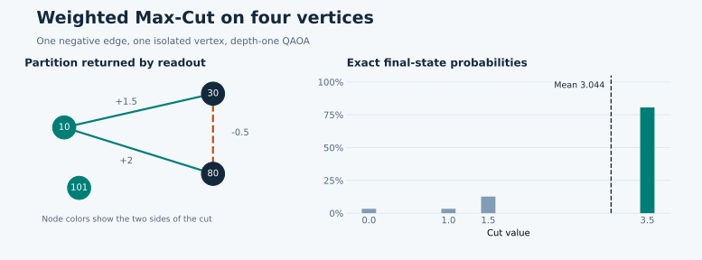

Weighted Max-Cut and QAOA
=========================

This chapter takes one object — an undirected graph with real weights, some of
them negative — and carries it to numbers you can reproduce: the exact optimum of
a four-vertex example, the QAOA expectation at fixed angles, the probability that
one measurement reaches the optimum, and the identity a recursive reduction uses
when it removes a vertex. The energy sign and the bit order are fixed first,
because every later chapter reads cuts and energies through them. Exact field
types and defaults live in the [API reference](API.md); the full convention table
is in `MATHEMATICS.md`.

Cut, energy, and the cost Hamiltonian
-------------------------------------

Let :math:`G=(V,\mathcal E)` be an undirected graph with finite real weights
:math:`w_{ij}`. A spin :math:`s_i\in\{-1,+1\}` says which side of the partition
contains vertex :math:`i`; an edge is cut when its endpoints lie on different
sides. The cut weight and the energy are

.. math::

   C_G(s) = \sum_{(i,j)\in\mathcal E} w_{ij}\frac{1-s_i s_j}{2},
   \qquad E(s)=-C_G(s).

A positive weight increases the objective when its edge is cut, a negative weight
decreases it, and an isolated vertex does not enter :math:`C_G` at all. Flipping
every spin at once leaves each product :math:`s_i s_j` unchanged, so a cut and its
global flip are the same partition. Lower energy therefore means a better cut.

QAOA works in the computational basis. A Pauli operator :math:`Z_i` has eigenvalue
:math:`s_i=1-2b_i` on the basis state whose bit for vertex :math:`i` is
:math:`b_i`. Substituting that relation into :math:`C_G` gives
:math:`H_E|b\rangle=E(s(b))|b\rangle` for

.. math::

   H_E = \sum_{(i,j)\in\mathcal E}\frac{w_{ij}}2(Z_iZ_j-I).

The scalar term only sets the zero of energy: dropping it changes the global phase
of :math:`e^{-i\gamma H_E}` but shifts every eigenvalue and every threshold that
is stated in absolute energy units. The library keeps the constant in
`IsingProblem.constant` so a reduction does not silently lose it.

Depth-one circuit and a closed-form check
-----------------------------------------

`ExactCPU` supplies the reference :math:`C^\star=\max_s C_G(s)` by enumeration.
`QAOACPU` starts from :math:`|+\rangle^{\otimes n}` and, on layer :math:`\ell`,
applies a phase operator and then a mixer:

.. math::

   U_\ell =
   \exp\!\left(-i\beta_\ell\sum_{i\in V}X_i\right)
   \exp\!\left(-i\gamma_\ell H_E\right).

The right-hand factor acts first. A configuration lists
:math:`\gamma_1,\dots,\gamma_p` before :math:`\beta_1,\dots,\beta_p`. The original
variational construction is due to
`Farhi, Goldstone, and Gutmann <https://arxiv.org/abs/1411.4028>`_.

One edge of weight :math:`w` is small enough to solve by hand. At :math:`p=1`,
after the phase operator the two cutting states :math:`|01\rangle` and
:math:`|10\rangle` carry amplitude :math:`e^{i\gamma w}/2`. After the mixer
:math:`e^{-i\beta X}\otimes e^{-i\beta X}`, each cutting amplitude is
:math:`(e^{i\gamma w}\cos(2\beta)-i\sin(2\beta))/2`. Adding the squared moduli
gives the probability that the edge is cut; multiplying by the weight gives

.. math::

   \mathbb E[C]=\frac{w}{2}
   \left[1-\sin(\gamma w)\sin(4\beta)\right].

At :math:`w=1,\ \gamma=-\pi/2,\ \beta=\pi/8` the expectation is
:math:`\mathbb E[C]=1`, with :math:`\langle H_E\rangle=-1` and
:math:`\langle Z_1Z_2\rangle=-1`. This single case checks three signs at once: the
sign of the cost Hamiltonian, the sign of the phase operator, and the sign of the
mixer. A sign error in any of them changes the correlator immediately. The same
one-edge family also shows the asymmetry of signed weights: at
:math:`\gamma=\pi/(2|w|)` and :math:`\beta=-\pi/8` the expected energy is
:math:`-|w|` for :math:`w>0` but :math:`0` for :math:`w<0`, because cutting a
negative edge lowers :math:`C`.

Training objectives and readout
-------------------------------

For a state :math:`|\psi\rangle` the probability of a basis outcome :math:`b` is
:math:`P(b)=|\langle b|\psi\rangle|^2`. The `mean_cut` objective averages
:math:`C_G` over that distribution. The other criteria act on the same
distribution: `cvar` averages the best :math:`\alpha` share of the probability
mass, `gibbs` returns a scaled log-sum-exp,
:math:`\log\!\left(\sum_b P(b)e^{\eta C(b)}\right)/\eta`, `best_of_k` returns the
expected maximum over :math:`K` independent draws, and `threshold_probability`
returns the mass of outcomes with :math:`C_G` at or above a threshold.
`expected_cut` is a different field: it is always the physical expectation of
:math:`C_G` in the final simulator state, not the optimized criterion.

`estimation.mode="exact"` evaluates a criterion over the whole probability vector;
`estimation.mode="shots"` estimates it from simulator samples. One full
central-difference step at :math:`p` layers needs one evaluation at the centre and
two probes for each of the :math:`2p` angles. If every evaluation uses
:math:`M_{\rm train}` shots, the step spends :math:`(4p+1)M_{\rm train}` training
shots; shots used for readout are counted separately. Both modes model an ideal
measurement without hardware noise.

Readout is a separate random choice. If one shot clears a cut threshold with
probability :math:`q`, then :math:`M` independent shots clear it at least once with
probability :math:`1-(1-q)^M`. Raising :math:`M` changes how the best measured
outcome is selected; it does not change the state or its expectation.

Worked example: four vertices, one negative edge
------------------------------------------------

`examples/public_quickstart.py` uses vertices `10, 30, 80, 101` with weights
:math:`w_{10,30}=1.5`, :math:`w_{10,80}=2`, and :math:`w_{30,80}=-0.5`; vertex
`101` is isolated. Enumerating the four possibilities gives
:math:`C_G\in\{0,\ 1,\ 1.5,\ 3.5\}`, so the optimum is `3.5`, attained when `10`
sits on one side and `30` and `80` on the other. Accounting for the global flip and
for the two values of spin `101`, four basis states reach that optimum.

.. code-block:: bash

   python examples/public_quickstart.py

The script builds `QAOACPU` with `seed=42`, one layer, `mean_cut`, exact
estimation, fixed initial angles `[-0.8, 0.4]`, and readout `best_of_shots` with
128 shots. Its printed result is:

.. code-block:: text

   Exact optimum                    3.500000
   Expected QAOA cut               3.044365
   Best cut in 128 simulated shots 3.500000
   Final-state optimal mass        0.805755
   Readout spins                   {10: 1, 30: -1, 80: -1, 101: 1}

The state index uses the least-significant bit for the first vertex of
`node_order`. The script rebuilds spins in that order and sums probability mass by
cut value; that reconstruction reproduces `expected_cut` to `1e-12`. The optimal
mass `0.805755` is the probability that a single ideal measurement returns an
optimal partition. It is close to, but not equal to, one: a good state is not the
same object as the optimum.

   Left: the partition returned by readout. Right: the distribution over cut
   values computed from the final statevector.

Removing a vertex without changing the objective
------------------------------------------------

A recursive method removes a vertex by fixing its spin relative to a neighbour. The
identity and the choice of constraint deserve separate checks. Let
:math:`s_u=\sigma s_v` with :math:`\sigma\in\{-1,+1\}`, and write
:math:`w_{ij}=0` for pairs that are not edges. Each edge :math:`(u,k)` splits as

.. math::

   \frac{w_{uk}}2(1-\sigma s_v s_k)
   = \frac{1-\sigma}2w_{uk}
   + \frac{\sigma w_{uk}}2(1-s_v s_k).

For :math:`k=v` the second term vanishes. Hence the reduced graph has
:math:`w'_{vk}=w_{vk}+\sigma w_{uk}` for :math:`k\notin\{u,v\}`, and for every
admissible spin assignment

.. math::

   C_G(s) = b + C_{G'}(s|_{V\setminus\{u\}}),
   \qquad b = \frac{1-\sigma}2 \sum_{k\ne u} w_{uk}.

Apply this to the worked example, removing `10` and keeping `30`. With
:math:`\sigma=-1` the offset is :math:`b=3.5` and :math:`w'_{30,80}=-2.5`; the
best cut compatible with that constraint is :math:`3.5`, the global optimum. With
:math:`\sigma=+1` the offset is :math:`b=0` and :math:`w'_{30,80}=1.5`, so the
best compatible cut is :math:`1.5`. The identity holds in both cases; preserving
the global optimum is a property of the chosen constraint, not of the identity. A
recursive scheme that picks constraints from measured correlations is described by
`Bravyi et al. <https://arxiv.org/abs/1910.08980>`_.

What these statements do not give
---------------------------------

- The closed form holds for one edge at depth one. Larger graphs have no such
  expression; use `AnalyticP1Evaluator` for exact depth-one values or `QAOACPU`
  for the circuit itself.
- `best_of_shots` returns the best measured outcome, which is not a certificate of
  a global optimum. Only enumeration or another certified method proves
  optimality.
- The simulator has no hardware noise. Shot noise in `estimation.mode="shots"`
  affects the optimizer trace, not the physics of the state.

Where next
----------

- [Concepts](CONCEPTS.md) — spins, bits, `node_order`, and what a solver returns.
- [Choosing an algorithm](CHOOSE_ALGORITHM.md) — when exact enumeration stops
  being affordable.
- [API reference](API.md) — objective fields, estimation modes, and exceptions.
- `MATHEMATICS.md` — the convention table behind every formula above.
